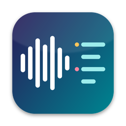

# Recscribe

**Back up recordings from a USB voice recorder, transcribe them on your own computer with speaker
separation, and turn them into minutes with your own AI key.**
No cloud account, no app, no Bluetooth. Audio never leaves your computer.

*Sichert Aufnahmen von einem USB-Diktiergerät, transkribiert sie lokal mit Sprechertrennung und
macht mit deinem eigenen KI-Schlüssel ein Protokoll daraus.*

Freeware for macOS, Linux and Windows.

## Download

Get the latest package from **[Releases](https://github.com/MatthiasHertel80/recscribe/releases/latest)**:

| System | File | Status |
|---|---|---|
| macOS 11+ (Apple Silicon and Intel) | `recscribe-<version>-macos-universal.zip` | best tested |
| Linux x86_64 | `recscribe-<version>-linux-x86_64.tar.gz` | automated tests |
| Linux aarch64 | `recscribe-<version>-linux-aarch64.tar.gz` | automated tests |
| Windows 10/11 x86_64 | `recscribe-<version>-windows-x86_64.zip` | beta |

Each package contains a `README.txt` (English and German) with the install steps. The programs are
**not code-signed**, so macOS and Windows warn on first start; the README shows how to proceed.
Verify downloads with `SHA256SUMS`.

## What it does

- Detects the recorder, copies new recordings with checksum verification, keeps a manifest.
- Converts the recorder's `.ops` files to Ogg Opus without re-encoding.
- Transcribes locally (Whisper large-v3-turbo; MLX on Apple Silicon, faster-whisper elsewhere)
  with local speaker separation. Output as Markdown, SRT and JSON.
- Name speakers by listening to short samples.
- Optional AI step: minutes, meeting notes, tasks, summaries, or your own templates, with your own
  key (Anthropic, OpenAI-compatible, or a local server such as Ollama).
- Optional: remove recordings from the recorder, only after a verified local copy.
- Native window in English and German, plus a full command line.

## Documentation

- [User guide (English)](docs/guide-en.md)
- [Handbuch (Deutsch, vollständig)](docs/handbuch.md)
- [Changelog](CHANGELOG.md)

## Requirements

Syncing needs nothing else. Transcription needs [`uv`](https://docs.astral.sh/uv/) and
[`ffmpeg`](https://ffmpeg.org/); the first run downloads the speech engine and models (about 2 GB).

## License and notices

Freeware, see [LICENSE.txt](LICENSE.txt) (English and German). Free to use, privately and
commercially, and to redistribute unmodified; not for sale. Open-source components are listed in
[THIRD-PARTY-NOTICES.txt](THIRD-PARTY-NOTICES.txt). Recscribe is an independent project and is not
affiliated with any recorder manufacturer.

The source code is not public. Bug reports and questions: use [Issues](../../issues).
