# Recscribe: User guide

Recscribe backs up recordings from a USB voice recorder, transcribes them on your own computer with
speaker separation, lets you name the speakers by ear, and turns transcripts into minutes or
meeting notes with your own AI key. No cloud account, no app, no Bluetooth. The recorder stays
unchanged unless you explicitly turn on removal. No audio leaves your computer. Only transcript
text does, and only if you use the AI step.

This guide covers installing Recscribe and using its window. The command line and technical
background are in the appendix. A fuller reference, in German, is the [Handbuch](handbuch.md).

Supported source today: USB recorders that store `.ops` files, tested with an AIREC recorder
(Jieli SoC, 64 GB, USB mass storage). Importing arbitrary audio files (WAV, MP3, M4A, voice memos)
is planned. Transcription, speakers and the AI step work on the files in the library folder and
do not depend on the source.

The screenshots show an invented weekly meeting with three speakers. All names and contents are
made up. The sample dialogue is in English; the window itself follows your system language.

## 1 The workflow in five steps

1. **Back up:** plug in the recorder and click *Sync now* in the Overview. The recordings are
   copied and checked against a checksum.
2. **Transcribe:** in *Transcription*, tick recordings and start. The program turns them into
   text with timestamps and separates the speakers.
3. **Read:** in *Transcripts*, read the text, search it, copy it, or open it as Markdown or SRT.
4. **Name speakers:** in *Speakers*, play short samples and type the names.
5. **Post-process (optional):** in *Post-processing*, a language model turns the transcript into
   minutes, meeting notes, tasks or a summary. You need your own API key for this.

You can also remove a backed-up recording from the recorder to free space (chapter 5). *Clean up*
(chapter 10) removes old recordings from the recorder and from the library in a controlled way.
Both only happen when you ask for them.

## 2 Installation

### What you need

| System | Package | Note |
|---|---|---|
| macOS 11 or later, Apple Silicon and Intel | `recscribe-<version>-macos-universal.dmg` | best tested; the fast MLX speech engine runs on Apple Silicon only, Intel Macs use faster-whisper |
| Windows 10 or 11, x86_64 | `recscribe-<version>-windows-x86_64-setup.exe` (or the `.zip`, no installation) | beta, not yet tested on many devices |
| Linux x86_64 | `recscribe-<version>-linux-amd64.deb` or `...-linux-x86_64.tar.gz` | Wayland or X11, graphics driver with Vulkan or OpenGL (usually Mesa) |
| Linux aarch64 | `recscribe-<version>-linux-arm64.deb` or `...-linux-aarch64.tar.gz` | as above |

Download the package from [Releases](https://github.com/MatthiasHertel80/recscribe/releases). Each
release has a `SHA256SUMS` file for checking the downloads (see below).

Backing up needs nothing else. **Transcription** needs two helper programs, `uv` and `ffmpeg`
(section "Helper programs for transcription").

The programs are not code-signed, so macOS and Windows warn on first start. The warning is
expected and takes two clicks to confirm, as described below.

### macOS

1. Open the `.dmg` and drag **Recscribe.app** to the Applications folder.
2. Start the app. The first time, macOS says it cannot verify it because it is not notarized by
   Apple. On macOS 15 and later: open **System Settings > Privacy & Security**, scroll down, click
   **"Open Anyway"** next to Recscribe and confirm. On macOS 14 and earlier: right-click the app,
   choose "Open" and click "Open" again. Or once in Terminal:

   ```sh
   xattr -dr com.apple.quarantine /Applications/Recscribe.app
   ```

3. The first time Recscribe reads the recorder, macOS asks for access to removable volumes. Allow
   it.

The command line tool is inside the app: `Recscribe.app/Contents/MacOS/recscribe`.

### Windows

1. Run `recscribe-<version>-windows-x86_64-setup.exe`. The wizard asks whether to install for you
   alone or for all users. The default, "only for me", needs no administrator rights and installs
   to `%LOCALAPPDATA%\Programs\Recscribe`.
2. SmartScreen may say "Windows protected your PC" because the program is not signed. Click
   **"More info"**, then **"Run anyway"**.
3. The wizard (English or German) adds a Start menu entry and an uninstaller (Settings > Apps).
   Optional: a desktop icon, and adding `recscribe` to `PATH` so the command line works in any
   PowerShell.
4. Start it from the Start menu: **Recscribe**.

No installation wanted? The `.zip` contains `recscribe.exe`. Unzip it anywhere and double-click.

Important on Windows: removable drives have no trash there. If you let Recscribe remove recordings
from the recorder, they are deleted for good (only after a verified copy exists, see chapter 5).

### Linux

Debian, Ubuntu, Linux Mint and derivatives:

```sh
sudo apt install ./recscribe-<version>-linux-amd64.deb
```

The package adds a **Recscribe** menu entry with an icon and recommends `ffmpeg`, which `apt`
normally installs along with it. Remove it with `sudo apt remove recscribe`.

Other distributions:

```sh
tar xzf recscribe-<version>-linux-x86_64.tar.gz
cd recscribe-<version>-linux-x86_64
./install.sh            # installs to ~/.local; remove with ./install.sh --remove
```

Or simply run `./recscribe` from the unpacked folder.

Your desktop has to mount the recorder (usually under `/run/media/<user>/...`). If it does not,
start the window with `recscribe gui --source /path/to/the/recorder`.

### Helper programs for transcription

| System | Commands |
|---|---|
| macOS | `brew install uv ffmpeg` |
| Windows | `winget install --id astral-sh.uv` and `winget install --id Gyan.FFmpeg` |
| Linux | `curl -LsSf https://astral.sh/uv/install.sh \| sh` and `sudo apt install ffmpeg` |

`uv` downloads the speech engine on first use (Python packages and models, about 2 GB together).
`ffmpeg` converts audio and plays the samples when you name speakers. After installing them,
restart Recscribe so it finds them. Once the models are downloaded, transcription also works
without a network (the "Offline" switch in the window).

### Checking the download

The `SHA256SUMS` file lists the checksum of every package. In the download folder:

```sh
shasum -a 256 -c SHA256SUMS --ignore-missing      # macOS and Linux
```

On Windows, in PowerShell: `Get-FileHash .\recscribe-<version>-windows-x86_64-setup.exe` and compare
it with the entry in `SHA256SUMS`.

### Update and uninstall

Install the new version over the old one to update. Your library, settings and speaker names stay.
To remove Recscribe: on macOS move the app to the Trash, on Windows use Settings > Apps, on Linux
use `apt remove` or `install.sh --remove`. Your library (`Aufnahmen/Recscribe` in your home
folder) is left untouched. If you stored an API key, it lives at the place named in chapter 12;
delete it in the window under "Post-processing" before you remove the program.

## 3 First start

Start Recscribe (double-click the app, Start menu, application menu). The window opens on the
**Overview**.

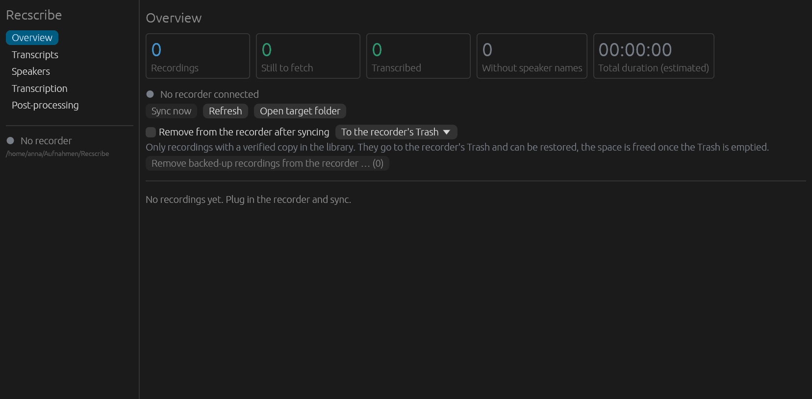

*Figure 1: First start.*

The navigation on the left has six views: Overview, Transcripts, Speakers, Transcription,
Post-processing and Clean up. Below it, a dot shows whether a recorder is connected (green) or not (grey), and
the path of the library. The content area starts with the counters, followed by the recorder
status and the buttons.

The **library** is the folder where all recordings and results end up: by default
`Aufnahmen/Recscribe` in your home folder. It is created on the first backup. To use another
place, start with `recscribe gui --dest /path/to/folder`.

The window is available in English and German and follows your system language (chapter 11).

## 4 The window at a glance

- **Navigation on the left:** switches between the six views. The recorder status below it
  refreshes every 10 seconds, so a freshly plugged-in recorder is noticed by itself. *Refresh*
  does it immediately.
- **Content on the right:** the chosen view.
- **Job area at the bottom:** appears as soon as a job runs (sync, transcription, removal,
  post-processing). It shows the job title, a progress bar, the current recording ("Recording 1 of
  3"), the stage (for example "Speech recognition") and the output lines below. **Cancel** ends
  the job, including the helper processes of uv and Python. When it is finished, it says "done",
  "cancelled" or "Error" and offers **Close**.
- **Messages:** short notes such as "Transcript copied" appear in the top right and disappear by
  themselves.

The window never freezes: sync and transcription run as a separate process. Only one job runs at a
time. While one is running, the start buttons of the others are disabled and give the reason ("A
job is already running").

## 5 Backing up recordings: the Overview

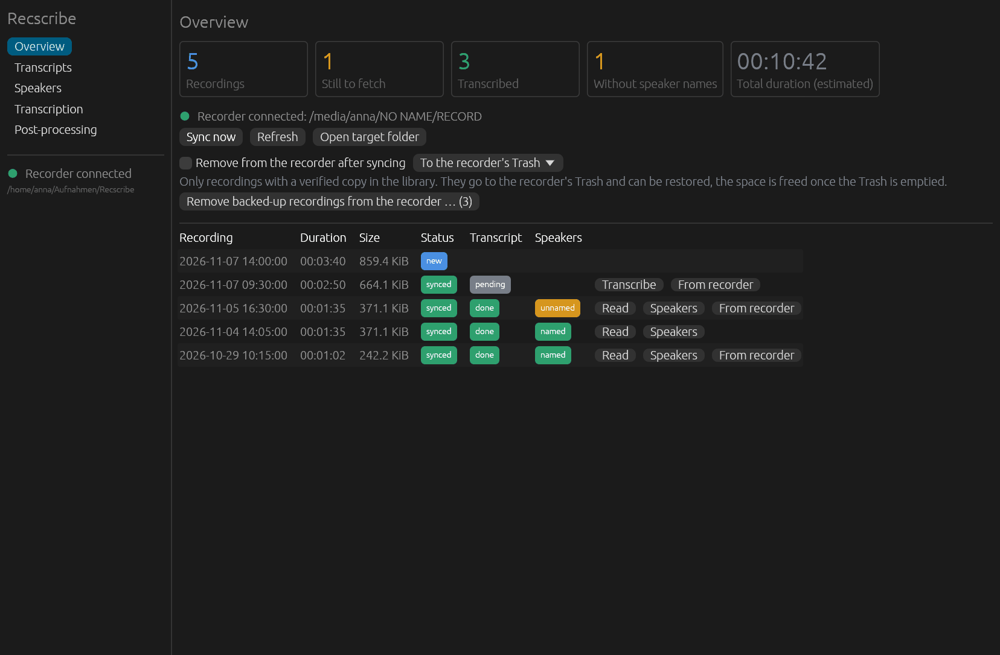

*Figure 2: The Overview.*

### Counters

Five tiles show the state: **Recordings** (all known ones, local and on the recorder), **Still to
fetch** (on the recorder but not yet in the library), **Transcribed**, **Without speaker names**
(transcribed, speakers still unnamed) and the **total duration**. The duration is an estimate based
on file size.

### Syncing

1. Plug in the recorder. Within 10 seconds at most, the window shows "Recorder connected" with the
   path of the drive.
2. Click **Sync now**.

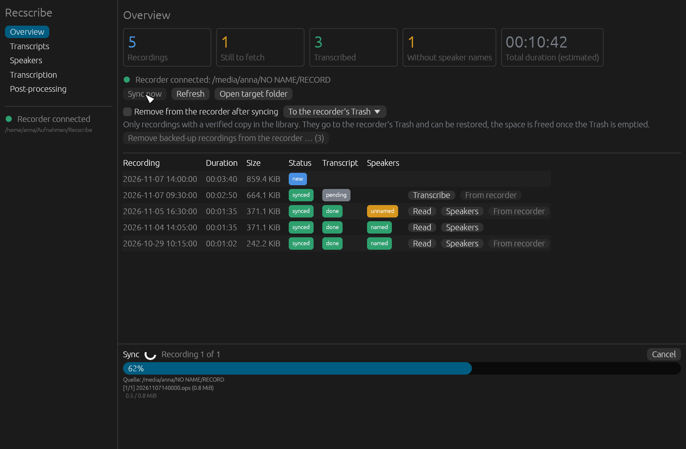

*Figure 3: A sync in progress.*

Each new file is first written to a file ending in `.part`, then read back, verified with SHA-256
and only then moved to its final name. An interruption loses nothing: the next sync carries on
where it stopped. Recordings that are still being made (the file is still growing) are skipped.

Files end up in `<library>/YYYY/MM/<recording time>.ops`, for example `2026/11/20261104140500.ops`.
The recording time is taken from the file name. The recorder's FAT timestamps are useless (it
reports the year 2047) and are never used.

Other buttons: **Refresh** re-reads the recorder and the library immediately, **Open target folder**
shows the library in your file manager.

### The list of recordings

| Column | Meaning |
|---|---|
| Recording | date and time, newest first |
| Duration, Size | estimated duration, file size |
| Status | **new** (only on the recorder), **synced** (backed up), **changed** (differs on the recorder from when it was backed up, updated at the next sync), **missing locally** (the copy in the library is gone and will be fetched again) |
| Transcript | **done** or **pending** |
| Speakers | **named** or **unnamed** (only once a transcript exists) |

On the right are the buttons for each recording: **Transcribe** (while there is no transcript),
**Read** and **Speakers** (once there is one), and **From recorder** (while the recording is still
on the recorder).

An empty list says "No recordings yet. Plug in the recorder and sync." With a recorder present but
nothing backed up, a hint reminds you to use "Sync now".

### Removing from the recorder

By default the recorder is only read. Freeing space is a deliberate decision, and there are three
ways to do it, all with the same safety net.

**Removal method** (dropdown in the Overview):

- **To the recorder's Trash:** recoverable. The files then sit in the drive's own trash (macOS:
  `.Trashes`, Linux: `.Trash-<uid>`). Space on the recorder is only freed once you empty that
  trash.
- **Delete permanently:** immediate and final. On Windows this is the only option, because
  removable drives have no trash there.

**Way 1: after every sync.** Tick **"Remove from the recorder after syncing"**. It then applies to
every sync, stays saved, and is off on first start.

**Way 2: all backed-up recordings at once.** Click **"Remove backed-up recordings from the
recorder … (n)"**. The number says how many recordings qualify. A confirmation appears.

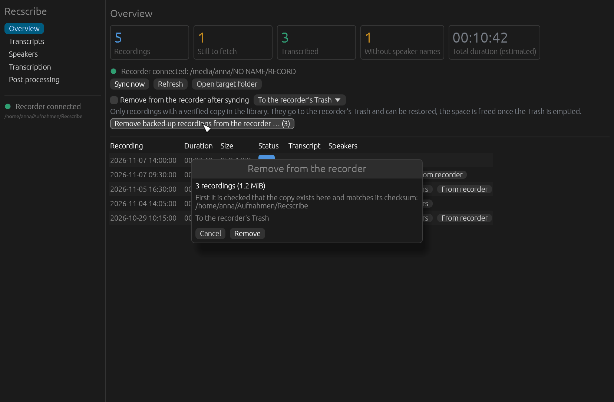

*Figure 4: Confirmation before removal.*

**Way 3: a single recording.** Click **From recorder** in its row, again with a confirmation. The
copy in the library always stays.

**When a recording may go.** Before removing, the program checks that everything matches:

- The catalogue (manifest) knows the recording, and its size matches the file on the recorder.
- The copy in the library exists and has the same size.
- Copy and recorder file are hashed once more and must match the stored SHA-256.
- Right before removal the size has not changed (the recording is not growing).

Whatever fails the check stays on the recorder. The confirmation names the count and size and, for
"Delete permanently", states it explicitly: "This cannot be undone." Only `.ops` files in the
`RECORD` folder qualify at all.

Not tested: how the recorder's firmware reacts afterwards. It only sees ordinary file system
changes. If you are unsure, stay with the Trash.

To remove old recordings by age and selection, also from the library: chapter 10.

## 6 Transcribing

The **Transcription** view turns backed-up recordings into text. Everything happens on your
computer, with no cloud service in between.

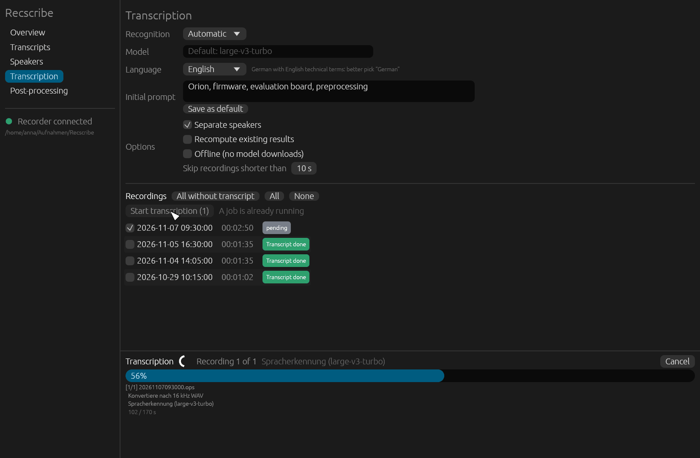

*Figure 5: Transcription with a running job.*

### Settings

| Field | Meaning |
|---|---|
| **Recognition** | **Automatic** chooses for you: MLX (Metal, fast) on Apple Silicon, faster-whisper elsewhere. You can pin either one. |
| **Model** | Leave empty: the default is `large-v3-turbo`, a Whisper model with good accuracy at reasonable speed. |
| **Language** | **Automatic**, German, English, French, Spanish or Italian. For mostly German conversations with English technical terms, "German" is usually better than Automatic. |
| **Initial prompt** | Technical terms and names that occur in the conversation (for example "Orion, firmware, evaluation board"). This improves recognition of exactly those words. **Save as default** keeps the text for future jobs. |
| **Separate speakers** | On: the program tells the speakers apart. The Speakers view needs this. |
| **Recompute existing results** | Also recomputes recordings that already have a transcript. Speaker names you assigned are kept. |
| **Offline** | No model downloads. Works only if the models were downloaded once. |
| **Skip recordings shorter than N s** | Default 10 seconds. Very short recordings are rarely worth transcribing. |

### Choosing recordings and starting

Below that is the list of local recordings with tick boxes. Three buttons above the list select
quickly: **All without transcript**, **All** and **None**. **Start transcription (n)** starts the
job. Progress, stage and output appear in the job area at the bottom.

The stages per recording: repacking the `.ops` file to Opus, converting to 16 kHz mono, speech
recognition, speaker separation, merging. The lines in the job area stay in German.

**The first transcription takes longer:** `uv` downloads Python packages and models (about 2 GB).
That happens once. After that, transcription also works without a network.

### What it produces

Next to the `.ops` file, the library then contains:

| File | Content |
|---|---|
| `<name>.opus` | the recording as Ogg Opus, playable in any player (not re-encoded, so in the recorder's quality) |
| `<name>.md` | the transcript in paragraphs with time and speaker |
| `<name>.srt` | subtitles with timestamps |
| `<name>.json` | the data for other programs |

If only speaker separation fails, the transcript is kept (without speakers) and recognition does
not have to be repeated.

## 7 Reading transcripts

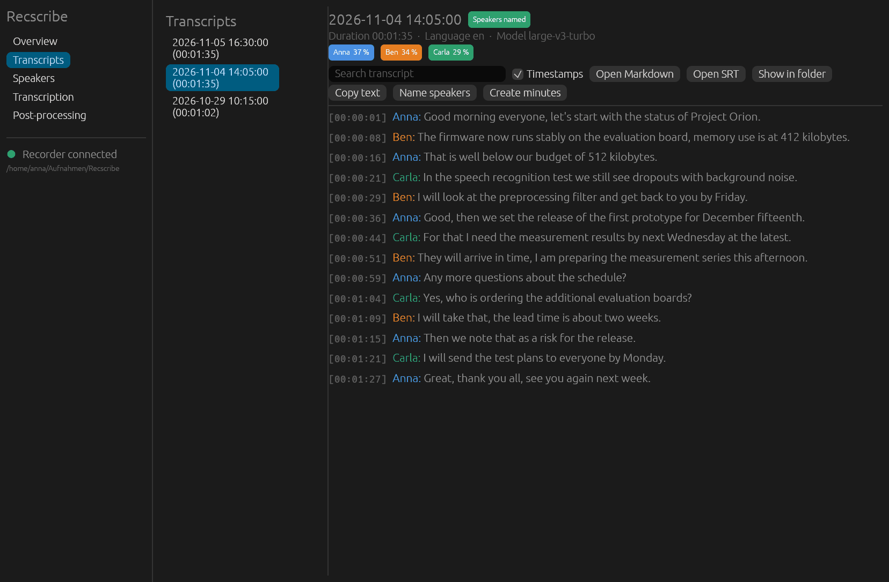

*Figure 6: The Transcripts view.*

On the left are all recordings with a transcript, on the right the chosen text. Each paragraph
starts with the timestamp and the speaker in their colour.

Above the text:

- **Header:** date of the recording, a green **"Speakers named"** badge once names are assigned,
  plus duration, language and model.
- **Speaker chips** with their share of talk time, for example "Anna 41 %".
- **Search transcript:** highlights hits and shows how many there are.
- **Timestamps:** shows or hides the timestamps.
- **Open Markdown** and **Open SRT:** open the files in your default program.
- **Show in folder:** shows the files in your file manager.
- **Copy text:** copies the whole transcript to the clipboard.
- **Name speakers:** jumps to the Speakers view for this recording.
- **Create minutes:** jumps to Post-processing (chapter 9).

Machine transcripts and speaker assignments can contain errors, especially with overlapping
speech, echo or similar voices. Spot-check by ear before relying on them.

## 8 Naming speakers

After transcription the speakers are called "Speaker 1", "Speaker 2" and so on. The **Speakers**
view turns them into names: you listen to short samples and enter who is talking.

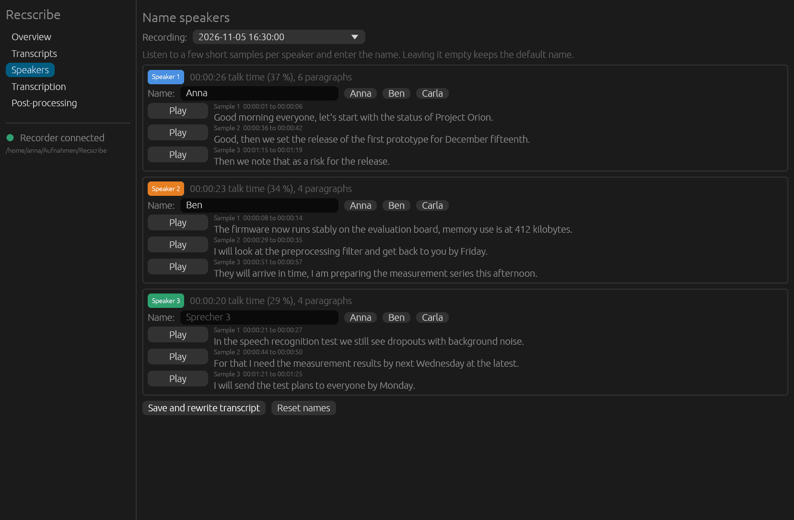

*Figure 7: Naming speakers by ear.*

1. Choose **the recording** in the dropdown at the top. The *Speakers* button in the Overview or
   in the transcript reader takes you here with the right recording already selected.
2. Each speaker has up to three **samples**: long, clean utterances without overlap, spread over
   the recording. **Play** plays one, **Stop** interrupts. Each sample shows its time range and
   text.
3. Enter the name in the **Name** field. Names from earlier recordings appear on the right as quick
   picks: one click takes them over. Leaving the field empty keeps the default name.
4. **Save and rewrite transcript** applies all names. Markdown, SRT and JSON are rewritten;
   recognition does not run again. **Reset names** discards the names of this recording.

Names apply per recording. There is no automatic recognition of the same voice across recordings
yet; known names are only offered as quick picks. They survive transcribing again.

The view needs an existing speaker separation. If there is none, it says: "No speaker separation
available. Run a transcription with speaker separation first." Cutting the samples needs
`ffmpeg`. They are played with `afplay` on macOS (built in), otherwise with `ffplay` (part of
`ffmpeg`), `paplay` or `aplay`.

## 9 Post-processing: minutes and meeting notes

A language model turns a transcript into minutes, meeting notes, a summary, a task list or
technical notes. The result is plain Markdown text, stored as `<recording>.<template>.md` next to
the transcript, for example `20261104140500.protokoll.md`.

You need **your own API key** (BYOK, "bring your own key"). There is no service of ours in between:
the program talks directly to the provider you choose.

### Processing a recording

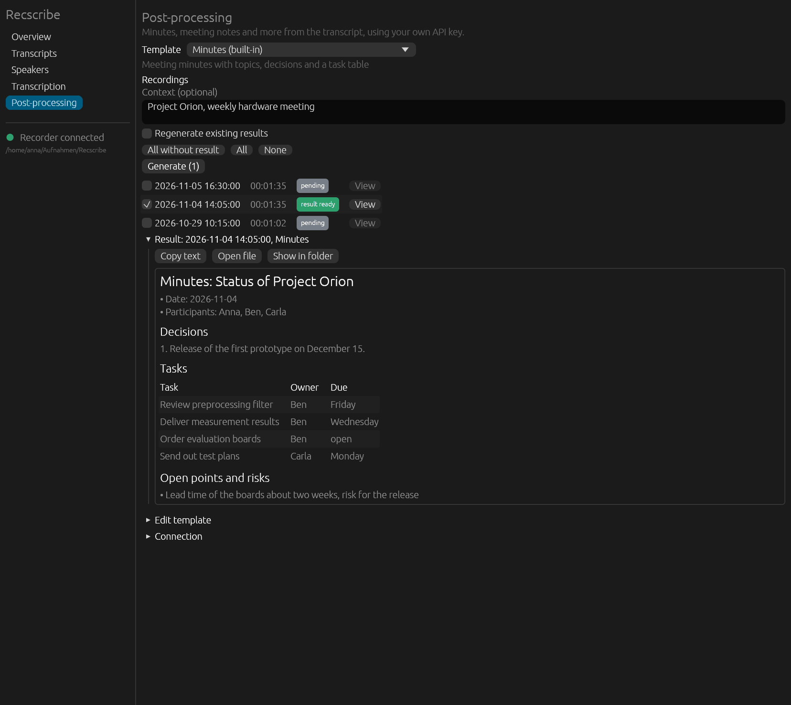

*Figure 8: Post-processing with a result.*

1. Choose a **Template**. Built in are **Minutes** (topics, decisions, task table), **Meeting
   notes** (compact, with action items), **Summary** (at most 150 words), **Tasks and decisions**
   (with a timestamp in the transcript) and **Technical notes** (decisions, numbers, problems,
   glossary). A description appears below the name.
2. Optionally enter **Context**: project, participants, purpose of the meeting. It helps the model
   get names and terms right.
3. **Tick** recordings. The buttons **All without result**, **All** and **None** help. The
   **result ready** badge shows where a result for this template already exists. **Regenerate
   existing results** makes those again too.
4. **Generate (n)** starts the job. Without a key or saved settings, the window says what is
   missing and does not start.
5. The **result** appears below. **Copy text** puts it on the clipboard, **Open file** opens the
   `.md` file, **Show in folder** shows it in your file manager. **View** in a row shows an
   existing result.

The transcript reader has a **Create minutes** button for this as well.

### Connection: provider, model and key

Under **Connection** (expands) you set whom the program talks to.

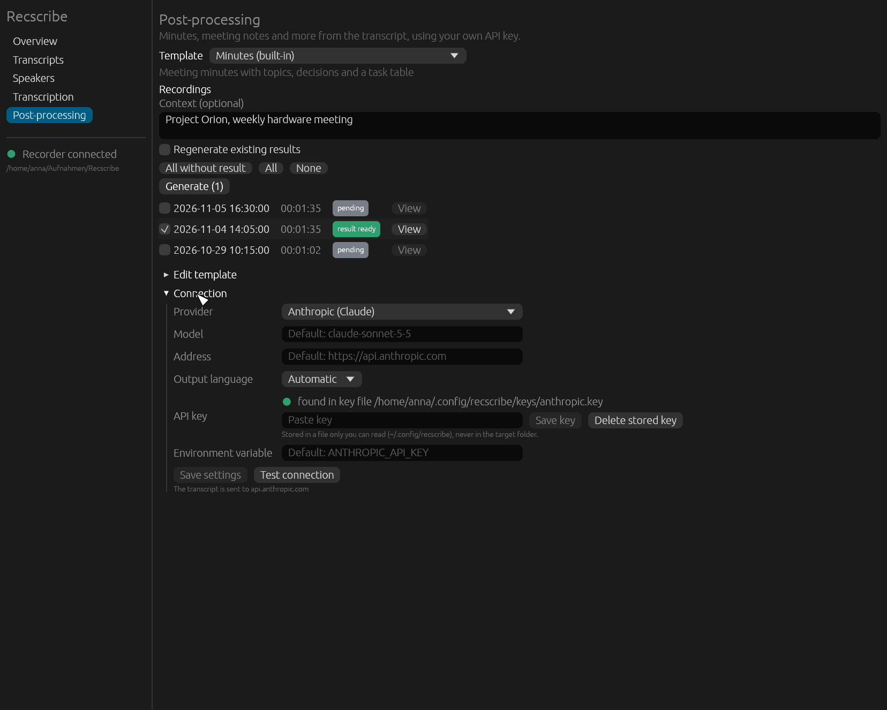

*Figure 9: Connection.*

| Field | Meaning |
|---|---|
| **Provider** | **Anthropic (Claude)** or **OpenAI-compatible** (OpenAI, OpenRouter, locally Ollama or LM Studio) |
| **Model** | Leave empty for the default (for Anthropic `claude-sonnet-5-5`). For OpenAI-compatible services, enter the model name. |
| **Address** | Leave empty for the default. For a local service, for example `http://localhost:11434/v1` (Ollama). |
| **Output language** | Automatic, German, English, French, Spanish or Italian |
| **API key** | shows where a key was found ("found in ...") or "no key found". Paste it here and click **Save key**, or **Delete stored key**. |
| **Environment variable** | name of the variable the key is read from (default for Anthropic: `ANTHROPIC_API_KEY`) |

Then **Save settings** and **Test connection**: this sends a short request and shows the reply, so
you can see whether key and model are right.

**Where the key lives.** When reading, the order is: environment variable, macOS keychain,
otherwise a file only you can read. On Linux that is `~/.config/recscribe/keys`, on Windows
`%APPDATA%\recscribe\keys`. It is never in the library folder (which may sit in a cloud) and never
in a settings file. A window you start from Finder or the Start menu does not see an environment
variable set in a terminal: simply save the key in the window.

**What is sent.** With a cloud provider, the whole transcript text goes to the provider. Below the
"Save settings" button it says which host. With a local service the transcript stays on your
computer and no key is needed. Without TLS (`http`) the program only sends the key to your own
computer (`localhost`) and otherwise aborts.

### Editing templates

Under **Edit template** (expands) you see the prompt of the chosen template and can change it. A
built-in template can be **copied as a custom template** and then adjusted, saved with **Save
template**, restored with **Reset to built-in** and removed with **Delete template**. Custom
templates are text files under `<library>/.recscribe/templates/`.

A prompt knows placeholders: `{{title}}`, `{{date}}`, `{{duration}}`, `{{speakers}}`, `{{notes}}`
(the context) and `{{transcript}}`. If `{{transcript}}` is missing, the program appends the
transcript at the end. An unknown placeholder is an error.

### Limits and caution

- **A model can make mistakes.** The system prompt demands not to invent anything (names, numbers,
  dates) and to mark uncertain parts with "(?)", but a model does not reliably comply. Read minutes
  before you distribute them, especially tasks, numbers and dates.
- **The transcript is wrapped in `<transcript>` tags**, and the system prompt tells the model it is
  data, not instructions. That helps against instructions smuggled into the spoken text but
  guarantees nothing.
- **Very long recordings** go through in one request (safety limit about 150,000 tokens). There is
  no splitting into sections yet.
- The reply is not streamed. If it gets cut off, this shows in the origin line of the result and as
  a warning in the job area.

## 10 Clean up: removing old recordings in a controlled way

Over time the recorder and the library fill up. The **Clean up** view removes old recordings with
full control: you filter by age, tick recordings, choose what should happen and confirm at the very
end. Nothing happens before that.

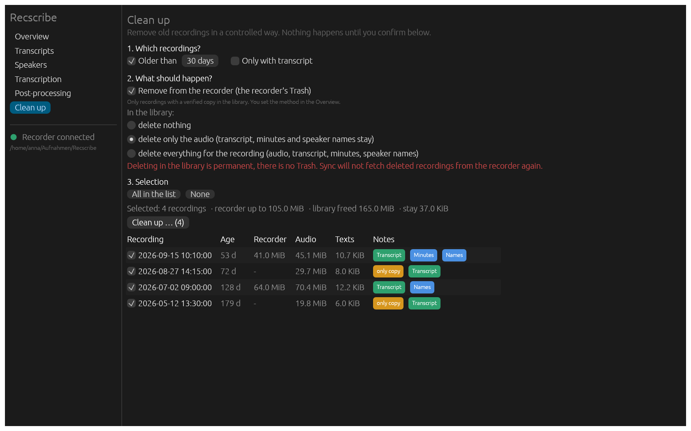

*Figure 10: The Clean up view.*

### 1. Which recordings

- **Older than N days:** The recording time from the file name counts, not the file's date.
  Recordings without a readable date are left out while the age filter is on.
- **Only with transcript:** So you never delete audio that has not been turned into text yet.
- In the list you tick recordings one by one, or use **All in the list** and **None**. Each row
  shows the age, the size on the recorder, the audio in the library, the texts and notes:
  Transcript, Minutes, Names and **only copy** when the recording is no longer on the recorder.

### 2. What should happen

| Action | Effect |
|---|---|
| **Remove from the recorder** | As in chapter 5, only with a verified copy in the library. You set the method (Trash or permanently) in the Overview. |
| In the library: **delete nothing** | The library stays as it is. |
| In the library: **delete only the audio** | Removes the `.ops`, `.opus` and `.wav` of the recording, including the 16 kHz file in the cache. Transcript (`.md`, `.srt`, `.json`), minutes, speaker names and intermediate results stay. You can still read and search the recording and have it summarised again. |
| In the library: **delete everything for the recording** | Also removes transcript, minutes, speaker names and intermediate results. The recording disappears from the list, and empty month folders are removed. |

Deleting in the library is permanent: there is no Trash there. That is deliberate and protected by
the confirmation. You can combine both actions. The recorder then goes first, because it needs the
local copy for its check, and the library follows.

### 3. Confirmation

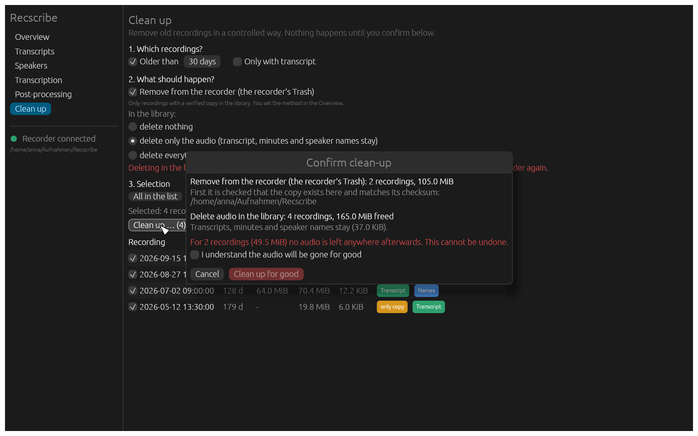

*Figure 11: Confirmation with preview.*

The confirmation names the count and size per action, how much space is freed and which recordings
stay on the recorder because no verified copy exists. Where **no audio is left anywhere**
afterwards, a red warning appears, and the **Clean up for good** button only becomes active once
you tick **I understand the audio will be gone for good**. That applies when the audio in the
library is deleted and the recording is not (or no longer) on the recorder, or is removed there
permanently. The recorder's Trash counts as a copy.

### Not fetched again

A sync would fetch again what you deleted and what is still on the recorder. A note in the manifest
prevents that: such recordings show as **removed** and are not copied any more. **Fetch again** in
the list takes the note back, and the next sync copies the recording again. Recordings deleted
completely that are only left on the recorder are listed below the list under **Only on the
recorder now, not fetched again**.

### What never happens

- Recordings that were never backed up are not touched in the library. There is nothing to delete
  there, and a note would prevent the first backup.
- In the library only files that belong to the recording disappear, and only inside the target
  folder. A twisted path in the manifest (with `..` or absolute) is refused. Recscribe never
  deletes links or folders.
- The recorder: only with the same checks as in chapter 5. What fails them stays there.
- The note is saved before deleting. If a run is interrupted, the next sync fetches nothing back,
  and a second run is harmless.
- No sync runs during clean-up (library lock).

The same on the command line: Appendix A, "Clean up on the command line".

## 11 Window language

The window follows the system language: German on a German system, otherwise English. On macOS the
first supported language from the language settings counts, on Windows the user's locale, on Linux
`LANGUAGE`, `LC_ALL`, `LC_MESSAGES` and `LANG`.

To override it at start: `recscribe gui --lang en` or `recscribe gui --lang de`, or the environment
variable `RECSCRIBE_LANG`.

The interface is translated. The lines in the job area (output of the command line program) and
the files (transcripts, default speaker name "Sprecher 1") stay German.

## 12 Where things are

| What | Where |
|---|---|
| Library | `Aufnahmen/Recscribe` in your home folder, or the folder from `--dest` or `RECSCRIBE_DEST` |
| Recordings and results | `<library>/YYYY/MM/<recording time>.ops`, `.opus`, `.md`, `.srt`, `.json`, `.<template>.md` |
| Overview page | `<library>/index.html` (counters, minutes per day, list), rewritten at every sync |
| Status files | `<library>/.recscribe/` (hidden): manifest with checksums and the "not fetched again" note (see chapter 10), speaker names, intermediate results, templates, settings |
| API key | macOS keychain; Linux `~/.config/recscribe/keys`; Windows `%APPDATA%\recscribe\keys`. Never in the library. |
| Models and Python packages | `uv` and Hugging Face caches in your home folder (about 2 GB) |

The library contains ordinary files only. You can back it up with any backup program and open the
results in other programs. Do not delete the hidden `.recscribe` folder: it holds what Recscribe
knows about the state of the backup.

## 13 Troubleshooting

**The recorder is not detected.** Check that it shows up as a drive in Finder, Explorer or your file
manager (the cable must carry data, not only charge). Then click "Refresh". A volume is recognised
by its structure: a `RECORD` folder plus a `SET.bin` file in the root, or existing `.ops` files.
The drive's name ("NO NAME") does not matter. On Linux your desktop has to mount the volume. If it
does not, start with `recscribe gui --source /path/to/mount`. On macOS, allow the removable
volumes prompt on first access.

**macOS says the app cannot be verified.** See chapter 2, macOS: "Open Anyway" in System Settings
under Privacy & Security.

**Windows SmartScreen blocks the installer.** "More info", then "Run anyway".

**On Linux the window does not open.** The window needs a desktop session (Wayland or X11) and a
graphics driver with Vulkan or OpenGL, usually Mesa. Without both, the program prints "Could not
open the window" in the terminal. The command line (Appendix A) also works without a window.

**Transcription does not start or reports that `uv` or `ffmpeg` is missing.** Install both
(chapter 2) and restart Recscribe. On macOS Recscribe also looks in `/opt/homebrew/bin` and
`/usr/local/bin`, on Linux in `~/.local/bin`.

**The first transcription takes very long.** It downloads about 2 GB of packages and models.
Progress shows in the job area. Afterwards it is much faster, and with "Offline" it needs no
network.

**Speakers are assigned wrongly.** Speaker changes in mid-sentence, simultaneous speech and
reverberant rooms are the weak spot of every speaker separation. It works well for recordings
close to the mouth. Check the assignment with the samples (chapter 8).

**"No API key found".** Under "Post-processing > Connection", paste the key and save it. A key in an
environment variable set in a terminal is invisible to a window you open from Finder or the Start
menu.

**A recording shows "changed" or "missing locally".** The next "Sync now" fetches it again. New
versions are written as `.part` and verified before they replace the old one.

**A recording shows "removed" and is not fetched any more.** That is intended: you deleted it in
Clean up, and sync leaves it on the recorder. **Fetch again** in Clean up releases it (chapter 10).

**Clean up does not want to remove something from the recorder.** The reason is in the output in the
job area: no verified copy, different size, checksum mismatch (chapter 5). The recording stays on
the recorder.

**A sync was interrupted.** Just start it again. A lock left behind by the interruption is taken
over as soon as the old process no longer exists.

More questions and bug reports: [Issues](https://github.com/MatthiasHertel80/recscribe/issues).

## 14 Privacy and notes

- No tracking, no analytics, no automatic update check.
- Network access happens in two places only: downloading the speech engine and models (first
  transcription) and, when you trigger it, sending transcript text to the AI service you set up.
- Audio never leaves your computer.
- Machine transcripts, speaker assignments and AI texts can be wrong. Check them before you rely on
  them.
- Record only where you may, and tell people they are being recorded where the law requires it.
- Terms: `LICENSE.txt` (freeware). Open-source components: `THIRD-PARTY-NOTICES.txt`. Recscribe is
  an independent project and not affiliated with any recorder manufacturer.

## Appendix A: Command line

Everything the window does is also available in a terminal (on Windows in PowerShell with
`.\recscribe.exe`; on macOS the program is inside the app at
`Recscribe.app/Contents/MacOS/recscribe`). The window calls the same commands, so there is no
second logic. `recscribe --help` and `recscribe <command> --help` list all options.

```sh
recscribe detect                 # show the detected recorder
recscribe status                 # compare the device with the sync state
recscribe sync --dry-run         # preview only
recscribe sync                   # copy new recordings
recscribe gui                    # open the window (--lang en, --dest DIR, --source DIR)
recscribe report --open          # open the HTML overview
recscribe convert                # repack .ops to .opus losslessly (--wav: also 16 kHz WAV)
recscribe transcribe             # transcribe locally, with speaker separation
recscribe speakers               # name the speakers by listening
recscribe delete --all           # remove backed-up recordings from the recorder
recscribe cleanup --older-than 90   # clean up old recordings (preview unless an action is given)
recscribe settings --delete-after-sync on    # remove after every sync
recscribe ai templates           # list the post-processing templates
recscribe ai run --template protokoll --notes "Project Orion"
recscribe ai run 20261104140500 --dry-run --print-prompt     # show what would be sent
recscribe install-agent          # sync automatically on plug-in (launchd, macOS)
```

Options for all commands (or via environment variable):

| Option | Variable | Default |
|---|---|---|
| `--dest DIR` | `RECSCRIBE_DEST` | `~/Aufnahmen/Recscribe` |
| `--source DIR` | `RECSCRIBE_SOURCE` | automatic detection |

`sync --delete-after` removes recordings after copying, for this run only. `delete` asks in the
terminal; without a terminal it needs `--yes`. `--dry-run` shows what would happen. `--method
trash|permanent` chooses the removal method.

### Clean up on the command line

`recscribe cleanup` selects recordings, shows them with sizes and, on request, carries out the
actions from chapter 10. Without `--recorder` and `--library` it is a preview only.

```sh
recscribe cleanup --older-than 90                         # preview: list with sizes
recscribe cleanup --older-than 90 --only-transcribed --library audio --dry-run
recscribe cleanup --older-than 90 --recorder --library audio    # asks in the terminal
recscribe cleanup 20260104140500 --library all --yes            # one recording, no question
recscribe cleanup --refetch 20260104140500                # undo "not fetched again"
```

| Option | Effect |
|---|---|
| `NAMES` | recordings such as `20260104140500` or `20260104140500.ops` |
| `--older-than DAYS` | only recordings at least that old (date from the file name) |
| `--only-transcribed` | only recordings with a transcript |
| `--all` | all recordings. Without names, `--older-than` or `--all` the command stops. |
| `--recorder` | remove from the recorder, only with a verified copy; `--method trash\|permanent` as for `delete` |
| `--library audio\|all` | delete permanently in the library: only the audio, or everything for the recording |
| `--dry-run` | shows the preview and summary, changes nothing |
| `--yes` | no question (required without a terminal) |
| `--refetch` | removes the note for the named recordings, the next sync fetches them again |

The summary before the question is the same as in the window, including the warning that no copy
will be left. The exit code is 1 if something failed.

The command output and the technical background (sync guarantees, the `.ops` format, the
transcription pipeline, templates and placeholders, key handling) are documented in detail in the
German [Handbuch](handbuch.md), Appendices A to D.

## Appendix B: Good to know

- The recorder's FAT timestamps are useless (year 2047). The recording time is read from the file
  name.
- The duration in the window and in reports is an estimate: file size divided by 4000 bytes per
  second. Converting knows the exact duration.
- A `.ops` file is a sequence of 80-byte Opus packets (SILK wideband, 20 ms, mono, 32 kbit/s).
  Converting repacks them into an Ogg container without re-encoding, so quality stays exactly that
  of the recorder.
- Planned: a general import of arbitrary audio files, Word export of the minutes, splitting long
  recordings for the AI step, recognising voices across recordings.

Terms of use: `LICENSE.txt`. Third-party components: `THIRD-PARTY-NOTICES.txt`. Changes:
`CHANGELOG.md`.
