# Recscribe: Handbuch

Recscribe sichert Aufnahmen von einem USB-Diktiergerät, transkribiert sie auf deinem Rechner mit
Sprechertrennung, lässt dich die Sprecher per Hörprobe benennen und macht mit deinem eigenen
KI-Schlüssel ein Protokoll oder Meeting Notes daraus. Kein Cloud-Konto, keine App, kein
Bluetooth. Der Rekorder bleibt unverändert, solange du das Entfernen nicht ausdrücklich
einschaltest. Kein Audio verlässt deinen Rechner, nur der Text eines Transkripts, und nur dann,
wenn du die KI-Weiterverarbeitung benutzt.

Dieses Handbuch erklärt Installation und Bedienung des Fensters. Die Kommandozeile und die
technischen Hintergründe stehen im Anhang.

Unterstützte Quelle heute: USB-Rekorder mit `.ops`-Dateien, getestet am AIREC (Jieli-SoC, 64 GB,
USB-Massenspeicher). Ein allgemeiner Import beliebiger Aufnahmen (WAV, MP3, M4A, Sprachmemos) ist
geplant. Transkription, Sprecher und KI-Teil arbeiten auf den Dateien im Zielordner und sind davon
unabhängig.

Die Bilder zeigen ein erfundenes Wochenmeeting mit drei Sprechern. Alle Namen und Inhalte sind
frei erfunden.

## 1 Der Ablauf in fünf Schritten

1. **Sichern:** Rekorder anstecken, in der Übersicht auf "Jetzt synchronisieren" klicken. Die
   Aufnahmen werden kopiert und per Prüfsumme kontrolliert.
2. **Transkribieren:** Unter "Transkription" Aufnahmen ankreuzen und starten. Das Programm macht
   daraus Text mit Zeitmarken und trennt die Sprecher.
3. **Lesen:** Unter "Transkripte" den Text lesen, durchsuchen, kopieren oder als Markdown oder
   SRT öffnen.
4. **Sprecher benennen:** Unter "Sprecher" kurze Hörproben abspielen und Namen eintragen.
5. **Weiterverarbeiten (optional):** Unter "Weiterverarbeitung" macht ein Sprachmodell ein
   Protokoll, Meeting Notes, Aufgaben oder eine Kurzfassung daraus. Dafür brauchst du einen eigenen
   API-Schlüssel.

Zusätzlich lässt sich eine gesicherte Aufnahme vom Rekorder entfernen, um Platz zu schaffen
(Kapitel 5). Unter "Aufräumen" (Kapitel 10) entfernst du alte Aufnahmen gezielt vom Rekorder und
aus der Bibliothek. Beides passiert nur auf deinen ausdrücklichen Wunsch.

## 2 Installation

### Was du brauchst

| System | Paket | Hinweis |
|---|---|---|
| macOS 11 oder neuer, Apple Silicon und Intel | `recscribe-<Version>-macos-universal.dmg` | am besten erprobt; die schnelle Spracherkennung mit MLX läuft nur auf Apple Silicon, auf Intel-Macs übernimmt faster-whisper |
| Windows 10 oder 11, x86_64 | `recscribe-<Version>-windows-x86_64-setup.exe` (oder `.zip`, ohne Installation) | Beta, noch nicht auf vielen Geräten erprobt |
| Linux x86_64 | `recscribe-<Version>-linux-amd64.deb` oder `...-linux-x86_64.tar.gz` | Wayland oder X11, Grafiktreiber mit Vulkan oder OpenGL (meist Mesa) |
| Linux aarch64 | `recscribe-<Version>-linux-arm64.deb` oder `...-linux-aarch64.tar.gz` | wie oben |

Die Pakete stehen unter [Releases](https://github.com/MatthiasHertel80/recscribe/releases). Zu
jedem Release gehört eine Datei `SHA256SUMS` zum Prüfen der Downloads (siehe unten).

Zum Sichern und Umwandeln brauchst du nichts weiter. Für die **Transkription** kommen zwei
Hilfsprogramme dazu, `uv` und `ffmpeg` (Abschnitt "Hilfsprogramme für die Transkription").

Die Programme sind nicht signiert. macOS und Windows warnen deshalb beim ersten Start. Die
Warnung ist erwartbar und lässt sich mit zwei Klicks bestätigen, wie unten beschrieben.

### macOS

1. Die `.dmg` öffnen und **Recscribe.app** auf den Ordner "Programme" ziehen.
2. Die App starten. macOS meldet beim ersten Mal, dass es sie nicht prüfen kann, weil sie nicht
   von Apple notarisiert ist. Ab macOS 15: **Systemeinstellungen > Datenschutz & Sicherheit**
   öffnen, nach unten scrollen, bei Recscribe auf **"Dennoch öffnen"** klicken und bestätigen.
   Bis macOS 14: mit Rechtsklick auf die App "Öffnen" wählen und noch einmal "Öffnen" klicken.
   Alternativ einmal im Terminal:

   ```sh
   xattr -dr com.apple.quarantine /Applications/Recscribe.app
   ```

3. Beim ersten Zugriff auf den Rekorder fragt macOS nach dem Zugriff auf Wechseldatenträger.
   Erlauben.

Das Kommandozeilenprogramm steckt in der App: `Recscribe.app/Contents/MacOS/recscribe`.

### Windows

1. `recscribe-<Version>-windows-x86_64-setup.exe` ausführen. Der Assistent fragt, ob er für
   dich allein oder für alle Benutzer installieren soll. Die Vorgabe "nur für mich" braucht keine
   Administratorrechte und legt das Programm unter `%LOCALAPPDATA%\Programs\Recscribe` ab.
2. Windows SmartScreen meldet womöglich "Der Computer wurde durch Windows geschützt", weil das
   Programm nicht signiert ist. Auf **"Weitere Informationen"** klicken, dann auf
   **"Trotzdem ausführen"**.
3. Der Assistent (Deutsch oder Englisch) legt einen Eintrag im Startmenü und eine Deinstallation an
   (Einstellungen > Apps). Optional: ein Desktopsymbol und der Eintrag von `recscribe` in `PATH`,
   damit die Kommandozeile in jeder PowerShell funktioniert.
4. Starten über das Startmenü: **Recscribe**.

Ohne Installation: Die `.zip` enthält `recscribe.exe`. Entpacken, wohin du willst, und
doppelklicken.

Wichtig für Windows: Wechseldatenträger haben dort keinen Papierkorb. Wenn du Aufnahmen vom
Rekorder entfernen lässt, sind sie endgültig weg (nur nach geprüfter Kopie, siehe Kapitel 5).

### Linux

Debian, Ubuntu, Linux Mint und Abkömmlinge:

```sh
sudo apt install ./recscribe-<Version>-linux-amd64.deb
```

Das Paket legt einen Menüeintrag **Recscribe** mit Symbol an und empfiehlt `ffmpeg`, das `apt`
normalerweise gleich mitinstalliert. Entfernen: `sudo apt remove recscribe`.

Andere Distributionen:

```sh
tar xzf recscribe-<Version>-linux-x86_64.tar.gz
cd recscribe-<Version>-linux-x86_64
./install.sh            # installiert nach ~/.local, entfernen mit ./install.sh --remove
```

Oder einfach `./recscribe` aus dem entpackten Ordner starten.

Den Rekorder muss dein Desktop einhängen (meist unter `/run/media/<Benutzer>/...`). Tut er das
nicht, startest du das Fenster mit `recscribe gui --source /Pfad/zum/Rekorder`.

### Hilfsprogramme für die Transkription

| System | Befehle |
|---|---|
| macOS | `brew install uv ffmpeg` |
| Windows | `winget install --id astral-sh.uv` und `winget install --id Gyan.FFmpeg` |
| Linux | `curl -LsSf https://astral.sh/uv/install.sh \| sh` und `sudo apt install ffmpeg` |

`uv` lädt beim ersten Mal die Spracherkennung (Python-Pakete und Modelle, zusammen rund 2 GB).
`ffmpeg` wandelt Audio um und spielt die Hörproben bei der Sprecherbenennung ab. Nach der
Installation Recscribe einmal neu starten, damit es die Programme findet. Wenn die Modelle einmal
geladen sind, geht die Transkription auch ohne Netz (Schalter "Offline" im Fenster).

### Download prüfen

Die Datei `SHA256SUMS` listet die Prüfsumme jedes Pakets. Im Download-Ordner:

```sh
shasum -a 256 -c SHA256SUMS --ignore-missing      # macOS und Linux
```

Unter Windows in PowerShell: `Get-FileHash .\recscribe-<Version>-windows-x86_64-setup.exe` und mit
dem Eintrag in `SHA256SUMS` vergleichen.

### Update und Deinstallation

Ein Update ist die Installation der neuen Version über die alte. Deine Bibliothek, die
Einstellungen und die Namen bleiben erhalten. Zum Entfernen: macOS die App in den Papierkorb
ziehen, Windows über Einstellungen > Apps, Linux mit `apt remove` oder `install.sh --remove`. Die
Bibliothek (`Aufnahmen/Recscribe` im Benutzerordner) bleibt dabei unberührt. Hast du einen
API-Schlüssel gespeichert, liegt er an dem Ort aus Kapitel 12 und lässt sich im Fenster unter
"Weiterverarbeitung" löschen, bevor du das Programm entfernst.

## 3 Erster Start

Recscribe starten (Doppelklick auf die App, Startmenü, Menü der Programme). Das Fenster öffnet
sich mit der **Übersicht**.

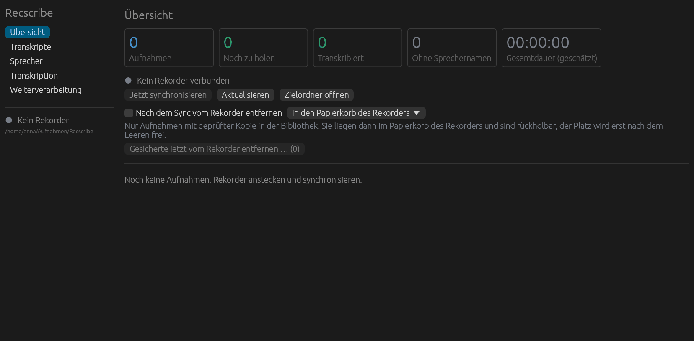

*Abbildung 1: Erster Start.*

Links steht die Navigation mit sechs Ansichten: Übersicht, Transkripte, Sprecher, Transkription,
Weiterverarbeitung und Aufräumen. Darunter zeigt ein Punkt, ob ein Rekorder verbunden ist (grün) oder nicht
(grau), und der Pfad der Bibliothek. Im Inhalt stehen oben die Kennzahlen, darunter der Rekorderstatus
und die Knöpfe.

Die **Bibliothek** ist der Ordner, in dem alle Aufnahmen und Ergebnisse landen: standardmäßig
`Aufnahmen/Recscribe` im Benutzerordner. Das Fenster legt ihn beim ersten Sichern an. Ein anderer
Ort lässt sich beim Start angeben: `recscribe gui --dest /Pfad/zum/Ordner`.

Das Fenster ist in Deutsch und Englisch verfügbar und folgt der Systemsprache (Kapitel 11).

## 4 Das Fenster im Überblick

- **Navigation links:** wechselt zwischen den sechs Ansichten. Der Rekorderstatus darunter
  aktualisiert sich alle 10 Sekunden, ein angesteckter Rekorder fällt also von selbst auf. Mit
  "Aktualisieren" geht es sofort.
- **Inhalt rechts:** die gewählte Ansicht.
- **Auftragsbereich unten:** erscheint, sobald ein Auftrag läuft (Synchronisieren, Transkription,
  Entfernen, Weiterverarbeitung). Er zeigt den Titel des Auftrags, einen Fortschrittsbalken, die
  laufende Aufnahme ("Aufnahme 1 von 3"), die Stufe (zum Beispiel "Spracherkennung") und darunter
  die Ausgabezeilen. Mit **"Abbrechen"** endet der Auftrag, auch die Hilfsprozesse von uv und
  Python. Ist er fertig, steht dort "fertig", "abgebrochen" oder "Fehler" mit einem Knopf
  **"Schließen"**.
- **Meldungen:** kurze Hinweise wie "Transkript kopiert" erscheinen oben rechts und
  verschwinden von selbst.

Das Fenster friert nie ein: Sync und Transkription laufen als eigener Prozess. Es läuft immer nur
ein Auftrag zur selben Zeit. Während einer läuft, sind die Startknöpfe der anderen gesperrt und
nennen den Grund ("Es läuft bereits ein Auftrag").

## 5 Aufnahmen sichern: die Übersicht

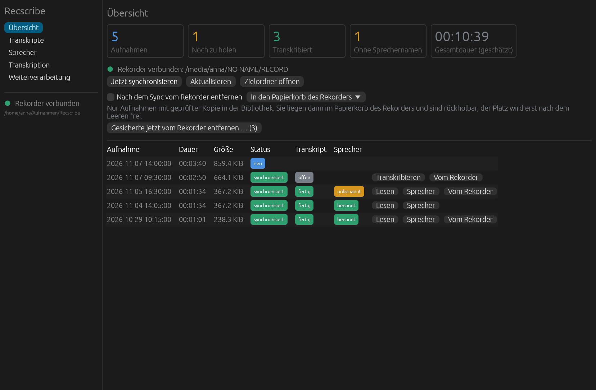

*Abbildung 2: Die Übersicht.*

### Kennzahlen

Fünf Kacheln zeigen den Stand: **Aufnahmen** (alle bekannten, lokal und auf dem Rekorder),
**Noch zu holen** (auf dem Rekorder, aber noch nicht in der Bibliothek), **Transkribiert**,
**Ohne Sprechernamen** (transkribiert, aber Sprecher noch unbenannt) und die **Gesamtdauer**. Die
Dauer ist eine Schätzung aus der Dateigröße.

### Synchronisieren

1. Rekorder anstecken. Nach spätestens 10 Sekunden zeigt das Fenster "Rekorder verbunden" mit
   dem Pfad des Laufwerks.
2. Auf **"Jetzt synchronisieren"** klicken.

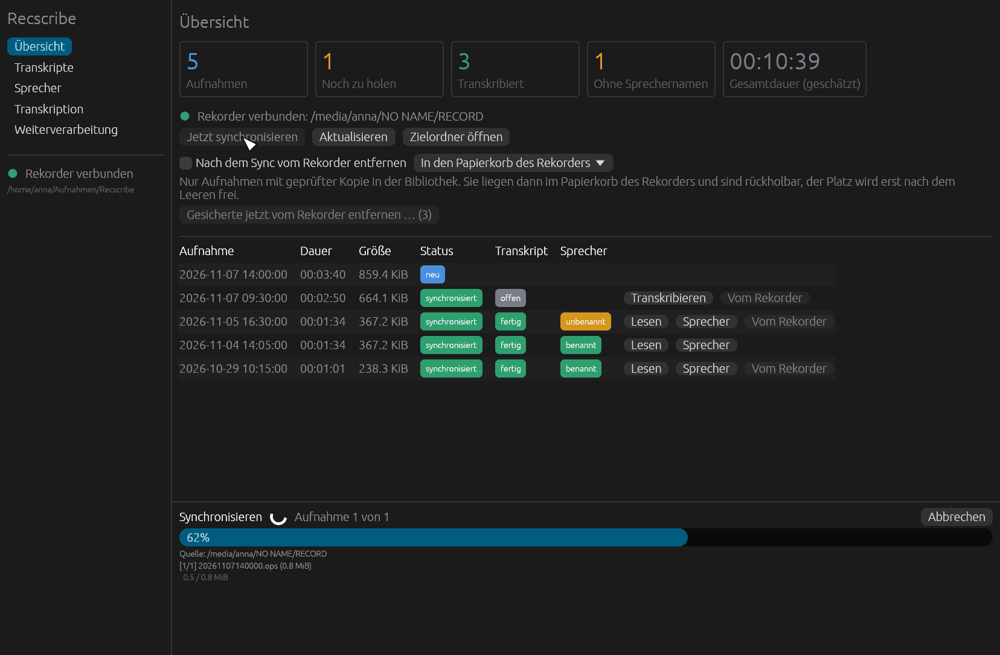

*Abbildung 3: Der Sync läuft.*

Jede neue Datei wird zuerst in eine Datei mit der Endung `.part` geschrieben, dann zurückgelesen,
per SHA-256 geprüft und erst danach unter dem endgültigen Namen abgelegt. Ein Abbruch verliert
nichts: Beim nächsten Sync wird dort weitergemacht. Aufnahmen, die in diesem Moment noch laufen
(die Datei wächst noch), überspringt das Programm.

Die Dateien landen unter `<Bibliothek>/JJJJ/MM/<Aufnahmezeit>.ops`, zum Beispiel
`2026/11/20261104140500.ops`. Die Aufnahmezeit steht im Dateinamen. Die FAT-Zeitstempel des
Rekorders sind unbrauchbar (er zeigt das Jahr 2047) und werden deshalb nie benutzt.

Weitere Knöpfe: **"Aktualisieren"** liest Rekorder und Bibliothek sofort neu, **"Zielordner
öffnen"** zeigt die Bibliothek im Dateimanager.

### Die Liste der Aufnahmen

| Spalte | Bedeutung |
|---|---|
| Aufnahme | Datum und Uhrzeit, neueste oben |
| Dauer, Größe | geschätzte Dauer, Dateigröße |
| Status | **neu** (nur auf dem Rekorder), **synchronisiert** (gesichert), **geändert** (auf dem Rekorder anders als beim Sichern, wird beim nächsten Sync aktualisiert), **lokal fehlt** (die Kopie in der Bibliothek ist weg und wird neu geholt) |
| Transkript | **fertig** oder **offen** |
| Sprecher | **benannt** oder **unbenannt** (nur bei fertigem Transkript) |

Rechts stehen die Knöpfe zur jeweiligen Aufnahme: **Transkribieren** (wenn es noch kein
Transkript gibt), **Lesen** und **Sprecher** (wenn eins da ist) und **Vom Rekorder** (wenn die
Aufnahme noch auf dem Rekorder liegt).

Ist die Liste leer, steht dort "Noch keine Aufnahmen. Rekorder anstecken und synchronisieren." Ist
ein Rekorder da, aber noch nichts gesichert, erinnert ein Hinweis an "Jetzt synchronisieren".

### Vom Rekorder entfernen

Standardmäßig wird der Rekorder nur gelesen. Platz schaffen ist eine bewusste Entscheidung, und es
gibt drei Wege, alle mit demselben Sicherheitsnetz.

**Art des Entfernens** (Auswahlfeld in der Übersicht):

- **In den Papierkorb des Rekorders:** rückholbar. Die Dateien liegen dann im Papierkorb des
  Datenträgers (macOS: `.Trashes`, Linux: `.Trash-<uid>`). Auf dem Rekorder wird erst Platz frei,
  wenn du diesen Papierkorb leerst.
- **Dauerhaft löschen:** sofort und endgültig. Unter Windows ist das die einzige Möglichkeit,
  weil Wechseldatenträger dort keinen Papierkorb haben.

**Weg 1: nach jedem Sync.** Den Haken bei **"Nach dem Sync vom Rekorder entfernen"** setzen. Er
gilt dann bei jedem Sync, bleibt gespeichert und steht beim ersten Start aus.

**Weg 2: alle gesicherten auf einmal.** Auf **"Gesicherte jetzt vom Rekorder entfernen … (n)"**
klicken. Die Zahl nennt, wie viele Aufnahmen infrage kommen. Es erscheint eine Rückfrage.

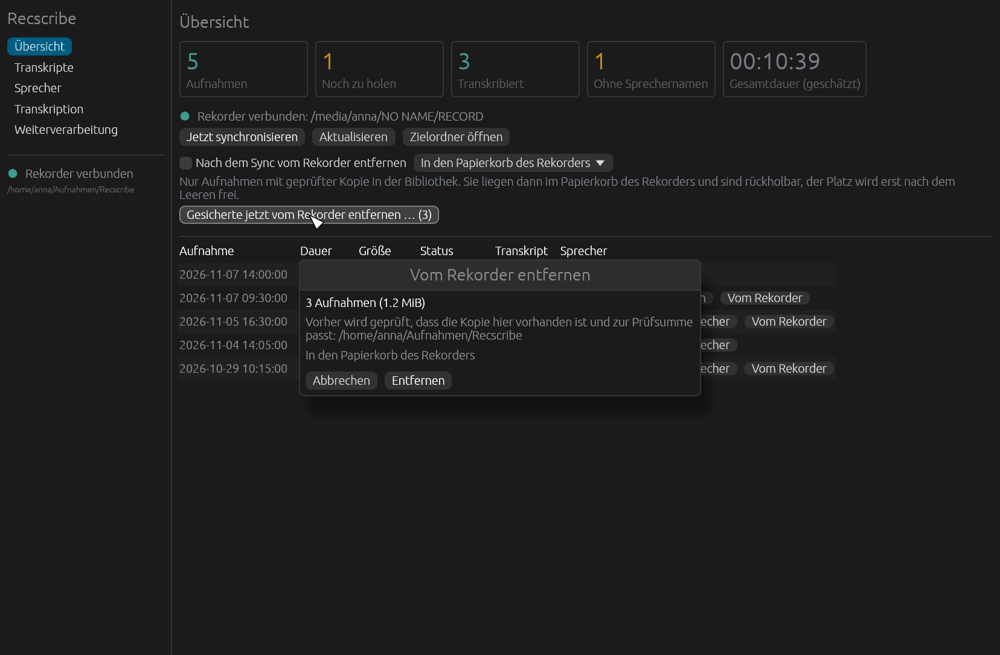

*Abbildung 4: Rückfrage vor dem Entfernen.*

**Weg 3: eine einzelne Aufnahme.** In der Zeile auf **"Vom Rekorder"** klicken, ebenfalls mit
Rückfrage. Die Kopie in der Bibliothek bleibt in jedem Fall erhalten.

**Wann eine Aufnahme weg darf.** Vor dem Entfernen prüft das Programm, ob alles stimmt:

- Das Verzeichnis (Manifest) kennt die Aufnahme, und ihre Größe passt zur Datei auf dem Rekorder.
- Die Kopie in der Bibliothek ist vorhanden und gleich groß.
- Kopie und Rekorderdatei werden noch einmal gehasht und müssen zur gespeicherten SHA-256 passen.
- Direkt vor dem Entfernen hat sich die Größe nicht geändert (die Aufnahme wächst nicht gerade).

Was die Prüfung nicht besteht, bleibt auf dem Rekorder. Die Rückfrage nennt Anzahl und Größe und,
bei "Dauerhaft löschen", ausdrücklich: "Das lässt sich nicht rückgängig machen." Nur
`.ops`-Dateien im Ordner `RECORD` kommen überhaupt infrage.

Nicht erprobt ist, wie die Firmware des Rekorders danach reagiert: Sie bekommt nur normale
Änderungen am Dateisystem mit. Wer unsicher ist, bleibt beim Papierkorb.

Alte Aufnahmen nach Alter und Auswahl entfernen, auch aus der Bibliothek: Kapitel 10.

## 6 Transkribieren

Die Ansicht **Transkription** macht aus gesicherten Aufnahmen Text. Alles geschieht auf deinem
Rechner, es gibt keinen Cloud-Dienst dazwischen.

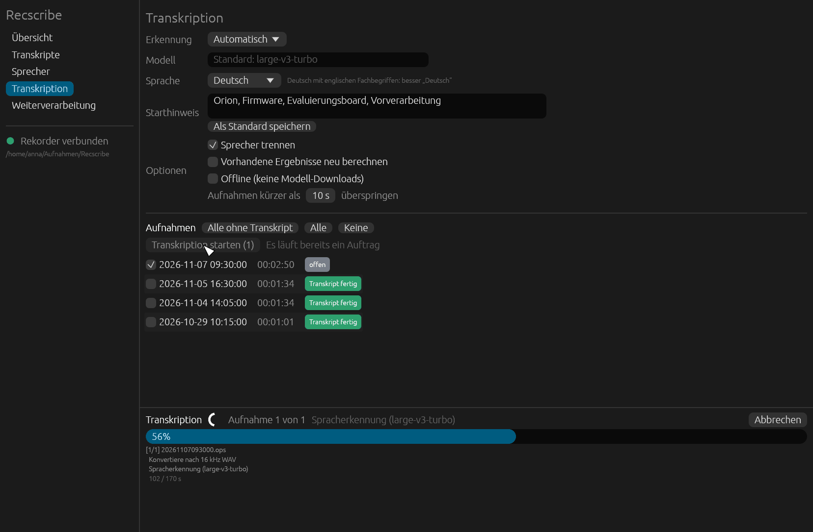

*Abbildung 5: Transkription mit laufendem Auftrag.*

### Einstellungen

| Feld | Bedeutung |
|---|---|
| **Erkennung** | **Automatisch** wählt selbst: auf Apple Silicon MLX (Metal, schnell), sonst faster-whisper. Beides lässt sich fest wählen. |
| **Modell** | Leer lassen: Standard ist `large-v3-turbo`, ein Whisper-Modell mit guter Genauigkeit bei vertretbarer Geschwindigkeit. |
| **Sprache** | **Automatisch**, Deutsch, Englisch, Französisch, Spanisch oder Italienisch. Bei überwiegend deutschen Gesprächen mit englischen Fachbegriffen ist "Deutsch" meist besser als Automatisch. |
| **Starthinweis** | Fachbegriffe und Namen, die im Gespräch vorkommen (zum Beispiel "Orion, Firmware, Evaluierungsboard"). Das verbessert die Erkennung genau dieser Wörter. **"Als Standard speichern"** merkt sich den Text für künftige Aufträge. |
| **Sprecher trennen** | An: Das Programm unterscheidet die Sprecher. Das braucht der Ansicht "Sprecher". |
| **Vorhandene Ergebnisse neu berechnen** | Rechnet auch Aufnahmen neu, die schon ein Transkript haben. Vergebene Sprechernamen bleiben erhalten. |
| **Offline** | Keine Modell-Downloads. Geht nur, wenn die Modelle schon einmal geladen wurden. |
| **Aufnahmen kürzer als N s überspringen** | Standard 10 Sekunden. Sehr kurze Aufnahmen lohnen die Transkription meist nicht. |

### Aufnahmen wählen und starten

Darunter steht die Liste der lokalen Aufnahmen mit Häkchen. Über der Liste wählen drei Knöpfe
schnell aus: **"Alle ohne Transkript"**, **"Alle"** und **"Keine"**. Mit **"Transkription starten
(n)"** läuft der Auftrag los. Fortschritt, Stufe und Ausgabe stehen im Auftragsbereich unten.

Die Stufen je Aufnahme: Umpacken der `.ops`-Datei nach Opus, Umwandeln nach 16 kHz mono,
Spracherkennung, Sprechertrennung, Zusammenführen. Die Zeilen im Auftragsbereich bleiben
deutsch.

**Die erste Transkription dauert länger:** `uv` lädt dabei Python-Pakete und Modelle (rund 2 GB).
Das passiert nur einmal. Danach geht die Transkription auch ohne Netz.

### Was dabei entsteht

Neben der `.ops`-Datei liegen danach in der Bibliothek:

| Datei | Inhalt |
|---|---|
| `<Name>.opus` | die Aufnahme als Ogg Opus, jeder Player kann sie abspielen (ohne Neukodierung, also in der Qualität des Rekorders) |
| `<Name>.md` | das Transkript in Absätzen mit Zeit und Sprecher |
| `<Name>.srt` | Untertitel mit Zeitmarken |
| `<Name>.json` | die Daten für andere Programme |

Scheitert nur die Sprechertrennung, bleibt das Transkript erhalten (ohne Sprecher), und die
Erkennung muss nicht wiederholt werden.

## 7 Transkripte lesen

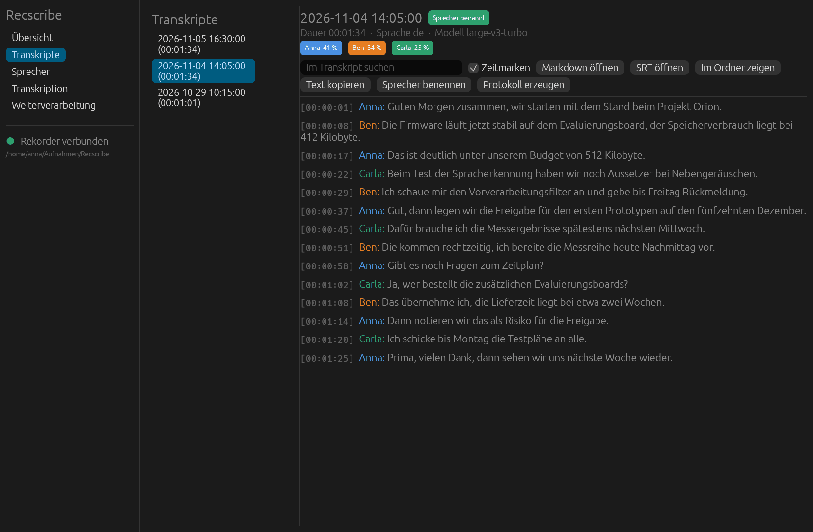

*Abbildung 6: Die Ansicht Transkripte.*

Links stehen alle Aufnahmen mit Transkript, rechts der gewählte Text. Jeder Absatz beginnt mit
der Zeitmarke und dem Sprecher in dessen Farbe.

Über dem Text:

- **Kopfzeile:** Datum der Aufnahme, ein grünes Zeichen **"Sprecher benannt"**, wenn Namen
  vergeben sind, sowie Dauer, Sprache und Modell.
- **Sprecherchips** mit dem Anteil an der Redezeit, zum Beispiel "Anna 41 %".
- **Im Transkript suchen:** markiert Treffer und zeigt ihre Anzahl.
- **Zeitmarken:** blendet die Zeitmarken ein oder aus.
- **Markdown öffnen** und **SRT öffnen:** öffnen die Dateien im Standardprogramm.
- **Im Ordner zeigen:** zeigt die Dateien im Dateimanager.
- **Text kopieren:** kopiert das ganze Transkript in die Zwischenablage.
- **Sprecher benennen:** springt zur Ansicht Sprecher für diese Aufnahme.
- **Protokoll erzeugen:** springt zur Weiterverarbeitung (Kapitel 9).

Maschinell erzeugte Transkripte und Sprecherzuordnungen können Fehler enthalten, vor allem bei
gleichzeitigem Sprechen, Nachhall oder ähnlichen Stimmen. Vor wichtigen Entscheidungen
stichprobenartig gegenhören.

## 8 Sprecher benennen

Nach der Transkription heißen die Sprecher "Sprecher 1", "Sprecher 2" und so weiter. Die Ansicht
**Sprecher** macht daraus Namen: Du hörst kurze Proben und trägst ein, wer spricht.

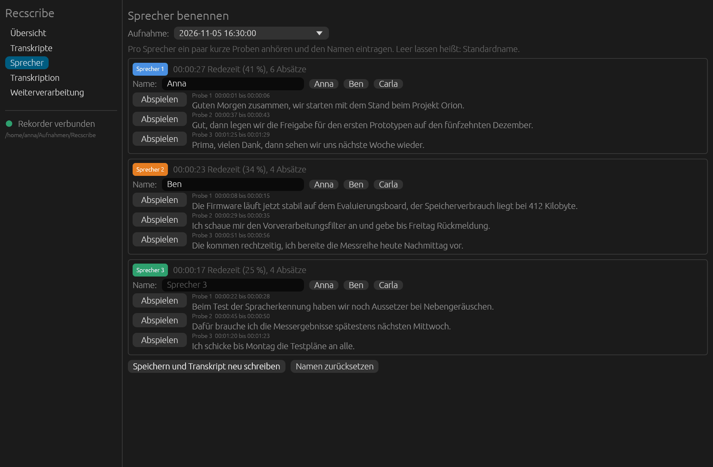

*Abbildung 7: Sprecher per Hörprobe benennen.*

1. Oben im Auswahlfeld **die Aufnahme** wählen. Über den Knopf "Sprecher" in der Übersicht oder im
   Transkriptleser kommst du mit der richtigen Aufnahme direkt hierher.
2. Je Sprecher stehen bis zu drei **Proben**: lange, saubere Äußerungen ohne Überlappung, über
   die Aufnahme verteilt. Mit **"Abspielen"** hörst du sie an, mit **"Stopp"** brichst du ab.
   Zu jeder Probe stehen Zeitraum und Text.
3. Im Feld **Name** den Namen eintragen. Namen aus früheren Aufnahmen stehen rechts als
   Schnellauswahl: ein Klick übernimmt sie. Bleibt das Feld leer, bleibt es beim Standardnamen.
4. **"Speichern und Transkript neu schreiben"** übernimmt alle Namen. Markdown, SRT und JSON
   werden neu geschrieben, die Erkennung läuft nicht noch einmal.
   **"Namen zurücksetzen"** verwirft die Namen dieser Aufnahme.

Die Namen gelten je Aufnahme. Eine automatische Wiedererkennung derselben Stimme über mehrere
Aufnahmen hinweg gibt es noch nicht, bekannte Namen werden nur als Auswahl angeboten. Sie
überleben ein erneutes Transkribieren.

Die Ansicht braucht eine vorhandene Sprechertrennung. Fehlt sie, steht dort: "Keine
Sprechertrennung vorhanden. Erst unter 'Transkription' mit Sprechertrennung starten." Zum
Schneiden der Proben braucht es `ffmpeg`. Abgespielt werden sie unter macOS mit `afplay` (ist
dabei), sonst mit `ffplay` (gehört zu `ffmpeg`), `paplay` oder `aplay`.

## 9 Weiterverarbeitung: Protokoll und Meeting Notes

Aus einem Transkript macht ein Sprachmodell ein Protokoll, Meeting Notes, eine Kurzfassung, eine
Aufgabenliste oder technische Notizen. Das Ergebnis ist reiner Markdown-Text und liegt als
`<Aufnahme>.<Vorlage>.md` neben dem Transkript, zum Beispiel `20261104140500.protokoll.md`.

Dafür brauchst du **einen eigenen API-Schlüssel** (BYOK, "bring your own key"). Es gibt keinen
Dienst von uns dazwischen: Das Programm spricht direkt mit dem Anbieter deiner Wahl.

### Eine Aufnahme verarbeiten

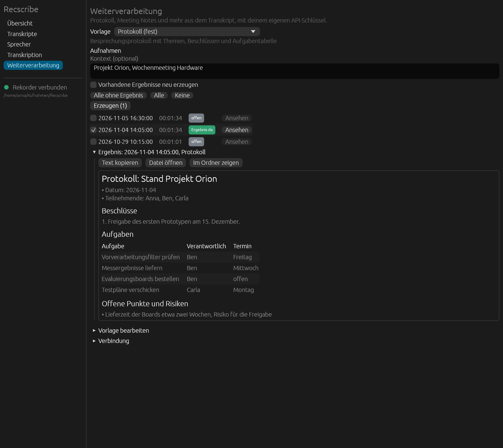

*Abbildung 8: Weiterverarbeitung mit einem Ergebnis.*

1. **Vorlage** wählen. Fest eingebaut sind **Protokoll** (Themen, Beschlüsse, Aufgabentabelle),
   **Meeting Notes** (kompakt, mit Action Items), **Zusammenfassung** (höchstens 150 Wörter),
   **Aufgaben und Entscheidungen** (mit Zeitmarke im Transkript) und **Technische Notizen**
   (Entscheidungen, Zahlen, Probleme, Glossar). Unter dem Namen steht eine Beschreibung.
2. Optional **Kontext** eintragen: Projekt, Teilnehmende, Ziel der Besprechung. Das hilft dem Modell,
   Namen und Begriffe richtig zu setzen.
3. Aufnahmen **ankreuzen**. Die Knöpfe **"Alle ohne Ergebnis"**, **"Alle"** und **"Keine"** helfen
   dabei. Das Zeichen **"Ergebnis da"** zeigt, wo für diese Vorlage schon ein Ergebnis liegt. Mit
   **"Vorhandene Ergebnisse neu erzeugen"** werden auch diese neu gemacht.
4. **"Erzeugen (n)"** startet den Auftrag. Ohne Schlüssel oder gespeicherte Einstellungen meldet das
   Fenster, was fehlt, und startet nicht.
5. Das **Ergebnis** erscheint darunter. **"Text kopieren"** legt es in die Zwischenablage,
   **"Datei öffnen"** öffnet die `.md`-Datei, **"Im Ordner zeigen"** zeigt sie im Dateimanager.
   **"Ansehen"** in der Zeile zeigt ein vorhandenes Ergebnis.

Auch der Transkriptleser hat dafür den Knopf "Protokoll erzeugen".

### Verbindung: Anbieter, Modell und Schlüssel

Unter **"Verbindung"** (klappt auf) stellst du ein, mit wem das Programm spricht.

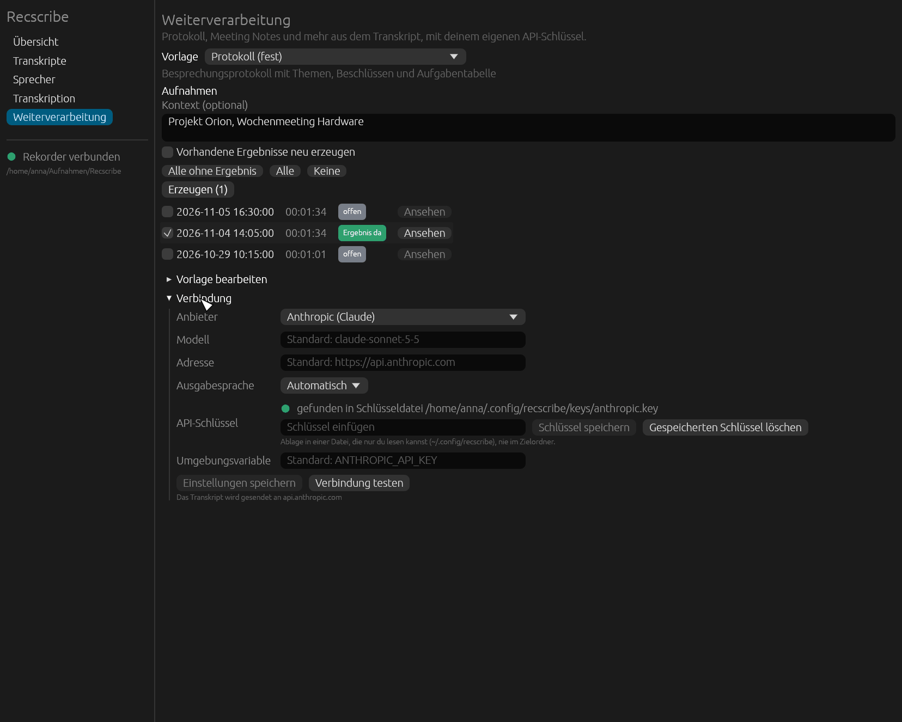

*Abbildung 9: Verbindung.*

| Feld | Bedeutung |
|---|---|
| **Anbieter** | **Anthropic (Claude)** oder **OpenAI-kompatibel** (OpenAI, OpenRouter, lokal Ollama oder LM Studio) |
| **Modell** | Leer lassen für den Standard (bei Anthropic `claude-sonnet-5-5`). Bei OpenAI-kompatiblen Diensten den Modellnamen eintragen. |
| **Adresse** | Leer lassen für den Standard. Für einen lokalen Dienst zum Beispiel `http://localhost:11434/v1` (Ollama). |
| **Ausgabesprache** | Automatisch, Deutsch, Englisch, Französisch, Spanisch oder Italienisch |
| **API-Schlüssel** | zeigt, wo ein Schlüssel gefunden wurde ("gefunden in ...") oder "kein Schlüssel gefunden". Hier einfügen und **"Schlüssel speichern"**, oder **"Gespeicherten Schlüssel löschen"**. |
| **Umgebungsvariable** | Name der Variable, aus der der Schlüssel gelesen wird (Standard bei Anthropic: `ANTHROPIC_API_KEY`) |

Danach **"Einstellungen speichern"** und **"Verbindung testen"**: Das schickt eine kurze Anfrage und
zeigt die Antwort, so siehst du, ob Schlüssel und Modell stimmen.

**Wo der Schlüssel liegt.** Beim Lesen gilt diese Reihenfolge: Umgebungsvariable, macOS-Schlüsselbund,
sonst eine Datei, die nur du lesen kannst. Auf Linux ist das `~/.config/recscribe/keys`, auf Windows
`%APPDATA%\recscribe\keys`. Er liegt nie im Zielordner (der kann in einer Cloud liegen) und nie in
einer Einstellungsdatei. Eine Umgebungsvariable aus dem Terminal sieht ein Fenster nicht, das du über
den Finder oder das Startmenü startest: Dort den Schlüssel einfach im Fenster speichern.

**Was gesendet wird.** Bei einem Cloud-Anbieter geht der gesamte Text des Transkripts an den Anbieter.
Unter dem Knopf "Einstellungen speichern" steht, an welchen Rechner. Bei einem lokalen Dienst bleibt
das Transkript auf dem Rechner, ein Schlüssel ist dort nicht nötig. Ohne TLS (`http`) sendet das
Programm den Schlüssel nur an den eigenen Rechner (`localhost`), sonst bricht es ab.

### Vorlagen bearbeiten

Unter **"Vorlage bearbeiten"** (klappt auf) siehst du den Prompt der gewählten Vorlage und kannst
ihn ändern. Eine feste Vorlage lässt sich als **eigene Vorlage kopieren** und dann anpassen, mit
**"Vorlage speichern"** sichern, mit **"Auf feste Fassung zurücksetzen"** wiederherstellen und mit
**"Vorlage löschen"** entfernen. Eigene Vorlagen liegen als Textdateien unter
`<Bibliothek>/.recscribe/templates/`.

In einem Prompt gibt es Platzhalter: `{{title}}`, `{{date}}`, `{{duration}}`, `{{speakers}}`,
`{{notes}}` (der Kontext) und `{{transcript}}`. Fehlt `{{transcript}}`, hängt das Programm das
Transkript unten an. Ein unbekannter Platzhalter ist ein Fehler.

### Grenzen und Vorsicht

- **Ein Modell kann Fehler machen.** Der Systemprompt verlangt, nichts zu erfinden (Namen, Zahlen,
  Termine) und Unsicheres mit "(?)" zu markieren, aber ein Modell hält sich nicht garantiert
  daran. Protokolle vor dem Verteilen lesen, vor allem Aufgaben, Zahlen und Termine.
- **Das Transkript steht in `<transcript>`-Tags**, und der Systemprompt sagt dem Modell, dass darin
  Daten stehen und keine Anweisungen. Das schützt vor eingeschleusten Anweisungen im Gesprochenen,
  garantiert aber nichts.
- **Sehr lange Aufnahmen** gehen in einer einzigen Anfrage durch (Schutzgrenze rund 150000 Tokens).
  Ein Aufteilen in Abschnitte gibt es noch nicht.
- Die Antwort wird nicht gestreamt. Wird sie abgeschnitten, steht das in der Herkunftszeile des
  Ergebnisses und als Warnung im Auftragsbereich.

## 10 Aufräumen: alte Aufnahmen gezielt entfernen

Mit der Zeit füllen sich Rekorder und Bibliothek. Die Ansicht **"Aufräumen"** entfernt alte
Aufnahmen mit voller Kontrolle: Du filterst nach Alter, kreuzt an, wählst, was passieren soll, und
bestätigst ganz am Ende. Vorher passiert nichts.

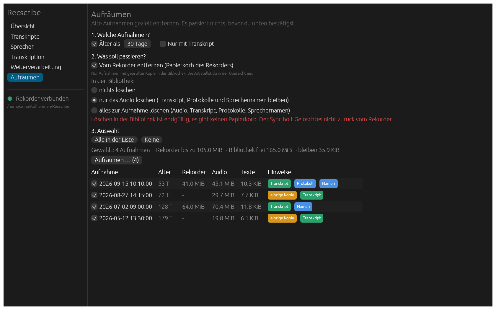

*Abbildung 10: Die Ansicht Aufräumen.*

### 1. Welche Aufnahmen

- **Älter als N Tage:** Maßgeblich ist die Aufnahmezeit aus dem Dateinamen, nicht das Datum der
  Datei. Aufnahmen ohne lesbares Datum bleiben bei aktivem Altersfilter außen vor.
- **Nur mit Transkript:** So löschst du kein Audio, aus dem noch kein Text entstanden ist.
- In der Liste kreuzt du einzeln an, oder du nimmst **"Alle in der Liste"** beziehungsweise
  **"Keine"**. Je Aufnahme siehst du das Alter, die Größe auf dem Rekorder, das Audio in der
  Bibliothek, die Texte und Hinweise: Transkript, Protokoll, Namen und **"einzige Kopie"**, wenn
  die Aufnahme nicht mehr auf dem Rekorder liegt.

### 2. Was soll passieren

| Aktion | Wirkung |
|---|---|
| **Vom Rekorder entfernen** | Wie in Kapitel 5, nur mit geprüfter Kopie in der Bibliothek. Die Art (Papierkorb oder dauerhaft) stellst du in der Übersicht ein. |
| In der Bibliothek: **nichts löschen** | Die Bibliothek bleibt, wie sie ist. |
| In der Bibliothek: **nur das Audio löschen** | Entfernt `.ops`, `.opus` und `.wav` der Aufnahme, auch die 16-kHz-Datei im Cache. Transkript (`.md`, `.srt`, `.json`), Protokolle, Sprechernamen und Zwischenergebnisse bleiben. Du kannst die Aufnahme weiter lesen, durchsuchen und neu zusammenfassen lassen. |
| In der Bibliothek: **alles zur Aufnahme löschen** | Entfernt zusätzlich Transkript, Protokolle, Sprechernamen und Zwischenergebnisse. Die Aufnahme verschwindet aus der Liste, leere Monatsordner werden mit entfernt. |

Löschen in der Bibliothek ist endgültig: Es gibt dort keinen Papierkorb. Das ist Absicht und
durch die Rückfrage abgesichert. Beide Aktionen lassen sich verbinden. Dann kommt zuerst der
Rekorder an die Reihe, weil er die lokale Kopie für die Prüfung braucht, danach die Bibliothek.

### 3. Rückfrage

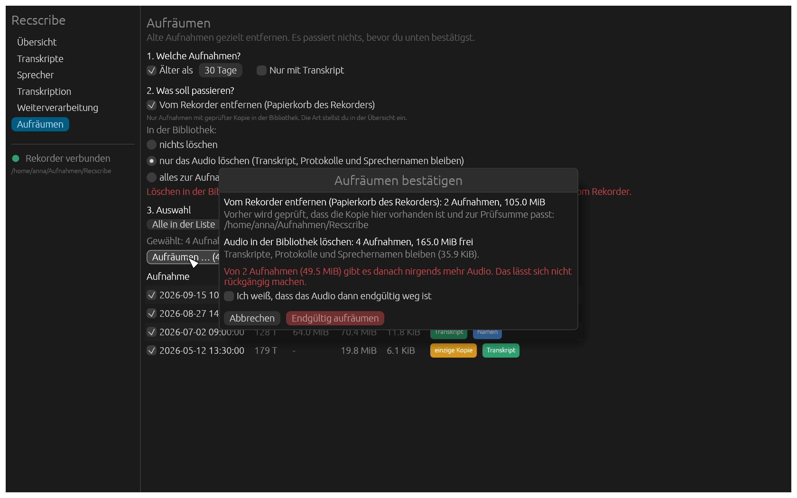

*Abbildung 11: Rückfrage mit Vorschau.*

Die Rückfrage nennt je Aktion Anzahl und Größe, wie viel Platz frei wird und welche Aufnahmen
auf dem Rekorder bleiben, weil keine geprüfte Kopie vorliegt. Wo danach **nirgends mehr Audio**
existiert, steht eine rote Warnung, und der Knopf **"Endgültig aufräumen"** wird erst aktiv, wenn
du **"Ich weiß, dass das Audio dann endgültig weg ist"** ankreuzt. Das gilt, wenn das Audio in der
Bibliothek gelöscht wird und die Aufnahme nicht (mehr) auf dem Rekorder liegt oder dort dauerhaft
entfernt wird. Der Papierkorb des Rekorders zählt als Kopie.

### Nicht neu holen

Ein Sync würde zurückholen, was du gelöscht hast und was noch auf dem Rekorder liegt. Das
verhindert ein Merkzettel im Manifest: Solche Aufnahmen stehen auf **"entfernt"** und werden nicht
mehr kopiert. In der Liste nimmt **"Wieder holen"** den Merkzettel zurück, beim nächsten Sync wird die
Aufnahme dann erneut kopiert. Komplett gelöschte Aufnahmen, die nur noch auf dem Rekorder liegen,
stehen unter der Liste im Abschnitt **"Nur noch auf dem Rekorder, wird nicht neu geholt"**.

### Was nie passiert

- Aufnahmen, die nie gesichert wurden, fasst Aufräumen in der Bibliothek nicht an. Es gibt dort
  nichts zu löschen, und ein Merkzettel würde die erste Sicherung verhindern.
- In der Bibliothek verschwinden nur Dateien, die zu der Aufnahme gehören, und nur im Zielordner.
  Ein verdrehter Pfad im Manifest (mit `..` oder absolut) wird abgelehnt. Verknüpfungen und Ordner
  löscht Recscribe nie.
- Der Rekorder: nur mit denselben Prüfungen wie in Kapitel 5. Was sie nicht besteht, bleibt dort.
- Der Merkzettel wird vor dem Löschen gespeichert. Bricht ein Lauf ab, holt der nächste Sync nichts
  zurück, und ein zweiter Lauf ist harmlos.
- Während des Aufräumens läuft kein Sync (Sperre der Bibliothek).

Dasselbe auf der Kommandozeile: Anhang A, "Aufräumen auf der Kommandozeile".

## 11 Sprache des Fensters

Das Fenster folgt der Systemsprache: Deutsch bei einem deutschen System, sonst Englisch. Unter
macOS zählt die erste unterstützte Sprache aus den Spracheinstellungen, unter Windows das
Gebietsschema des Benutzers, unter Linux `LANGUAGE`, `LC_ALL`, `LC_MESSAGES` und `LANG`.

Zum Überschreiben beim Start: `recscribe gui --lang en` oder `recscribe gui --lang de`, oder die
Umgebungsvariable `RECSCRIBE_LANG`.

Übersetzt ist die Oberfläche. Die Zeilen im Auftragsbereich (Ausgabe des Kommandozeilenprogramms)
und die Dateien (Transkripte, Standardname "Sprecher 1") bleiben deutsch.

## 12 Wo liegt was

| Was | Wo |
|---|---|
| Bibliothek | `Aufnahmen/Recscribe` im Benutzerordner, oder der Ordner aus `--dest` bzw. `RECSCRIBE_DEST` |
| Aufnahmen und Ergebnisse | `<Bibliothek>/JJJJ/MM/<Aufnahmezeit>.ops`, `.opus`, `.md`, `.srt`, `.json`, `.<Vorlage>.md` |
| Übersichtsseite | `<Bibliothek>/index.html` (Kennzahlen, Minuten pro Tag, Liste), wird bei jedem Sync neu geschrieben |
| Statusdateien | `<Bibliothek>/.recscribe/` (versteckt): Manifest mit Prüfsummen und dem Merkzettel "nicht neu holen" (siehe Kapitel 10), Sprechernamen, Zwischenergebnisse, Vorlagen, Einstellungen |
| API-Schlüssel | macOS Schlüsselbund; Linux `~/.config/recscribe/keys`; Windows `%APPDATA%\recscribe\keys`. Nie in der Bibliothek. |
| Modelle und Python-Pakete | Cache von `uv` und Hugging Face im Benutzerordner (rund 2 GB) |

Die Bibliothek enthält nur gewöhnliche Dateien. Du kannst sie mit jedem Backup-Programm sichern
und die Ergebnisse in anderen Programmen öffnen. Lösche nicht den versteckten Ordner `.recscribe`:
Dort steht, was Recscribe über den Stand der Sicherung weiß.

## 13 Probleme und Lösungen

**Der Rekorder wird nicht erkannt.** Prüfe, ob er als Laufwerk im Finder, Explorer oder
Dateimanager erscheint (das Kabel muss Daten übertragen, nicht nur laden). Dann auf "Aktualisieren"
klicken. Erkannt wird ein Datenträger an der Struktur: ein Ordner `RECORD` plus eine Datei `SET.bin`
im Wurzelverzeichnis, oder vorhandene `.ops`-Dateien. Der Name des Laufwerks ("NO NAME") spielt keine
Rolle. Unter Linux muss der Desktop den Datenträger einhängen. Falls nicht, mit
`recscribe gui --source /Pfad/zum/Mountpunkt` starten. Unter macOS beim ersten Zugriff die Abfrage zu
Wechseldatenträgern erlauben.

**macOS meldet, die App könne nicht geprüft werden.** Siehe Kapitel 2, macOS: "Dennoch öffnen" in
den Systemeinstellungen unter Datenschutz & Sicherheit.

**Windows SmartScreen blockiert die Installation.** "Weitere Informationen", dann "Trotzdem
ausführen".

**Unter Linux öffnet sich das Fenster nicht.** Das Fenster braucht eine Desktop-Sitzung (Wayland oder
X11) und einen Grafiktreiber mit Vulkan oder OpenGL, meist Mesa. Ohne beides meldet das Programm im
Terminal "Fenster konnte nicht geöffnet werden". Die Kommandozeile (Anhang A) funktioniert auch ohne
Fenster.

**Die Transkription startet nicht oder meldet, `uv` oder `ffmpeg` fehle.** Beide Hilfsprogramme
installieren (Kapitel 2) und Recscribe neu starten. Unter macOS sucht Recscribe auch in
`/opt/homebrew/bin` und `/usr/local/bin`, unter Linux in `~/.local/bin`.

**Die erste Transkription dauert sehr lange.** Sie lädt rund 2 GB an Paketen und Modellen. Der
Fortschritt steht im Auftragsbereich. Danach ist es deutlich schneller, und mit "Offline" braucht
es kein Netz mehr.

**Die Sprecher sind falsch zugeordnet.** Sprecherwechsel mitten im Satz, gleichzeitiges Sprechen und
Räume mit Nachhall sind die schwache Stelle jeder Sprechertrennung. Bei Aufnahmen nah am Mund ist
sie gut. Prüfe die Zuordnung mit den Hörproben (Kapitel 8).

**"Kein API-Schlüssel gefunden".** Unter "Weiterverarbeitung > Verbindung" den Schlüssel einfügen und
speichern. Ein Schlüssel in einer Umgebungsvariablen aus dem Terminal ist für ein Fenster unsichtbar,
das du per Finder oder Startmenü öffnest.

**Eine Aufnahme steht auf "geändert" oder "lokal fehlt".** Beim nächsten "Jetzt synchronisieren" wird
sie neu geholt. Neue Fassungen entstehen erst als `.part` und werden geprüft, bevor sie die alte ersetzen.

**Eine Aufnahme steht auf "entfernt" und wird nicht mehr geholt.** Das ist gewollt: Du hast sie unter
"Aufräumen" gelöscht, und der Sync lässt sie auf dem Rekorder liegen. Unter "Aufräumen" gibt
"Wieder holen" sie frei (Kapitel 10).

**"Aufräumen" will etwas nicht vom Rekorder entfernen.** Der Grund steht in der Ausgabe im
Auftragsbereich: keine geprüfte Kopie, andere Größe, Prüfsumme weicht ab (Kapitel 5). Die Aufnahme
bleibt dann auf dem Rekorder.

**Ein Sync brach ab.** Einfach noch einmal starten. Eine Sperre, die der Abbruch hinterlassen hat,
wird übernommen, sobald es den alten Prozess nicht mehr gibt.

Weitere Fragen und Fehlerberichte: [Issues](https://github.com/MatthiasHertel80/recscribe/issues).

## 14 Datenschutz und Hinweise

- Kein Tracking, keine Statistik, keine automatische Update-Prüfung.
- Netzwerkzugriffe gibt es nur an zwei Stellen: beim Herunterladen der Spracherkennung und der
  Modelle (erste Transkription) und, wenn du es auslöst, beim Senden des Transkripttexts an den
  KI-Dienst, den du eingerichtet hast.
- Audio verlässt den Rechner nie.
- Maschinelle Transkripte, Sprecherzuordnungen und KI-Texte können falsch sein. Prüfe sie, bevor
  du dich darauf verlässt.
- Nimm nur auf, wo du es darfst, und weise Beteiligte darauf hin, wo das Gesetz es verlangt.
- Bedingungen: `LICENSE.txt` (Freeware). Open-Source-Bausteine: `THIRD-PARTY-NOTICES.txt`. Recscribe
  ist ein unabhängiges Projekt und steht in keiner Verbindung zu einem Gerätehersteller.

## Anhang A: Kommandozeile

Alles, was das Fenster kann, geht auch im Terminal (unter Windows in PowerShell mit
`.\recscribe.exe`; unter macOS liegt das Programm in der App unter
`Recscribe.app/Contents/MacOS/recscribe`). Das Fenster ruft dieselben Befehle auf, es gibt also keine
zweite Logik. Mit `recscribe --help` und `recscribe <Befehl> --help` gibt es die vollständige
Optionsliste.

### Befehle

```sh
recscribe detect             # erkannten Rekorder anzeigen
recscribe status             # Gerät gegen Sync-Stand vergleichen
recscribe sync --dry-run     # nur anzeigen
recscribe sync               # neue Aufnahmen kopieren
recscribe gui                # Fenster öffnen (alles unten per Maus)
recscribe report --open      # HTML-Übersicht öffnen
recscribe convert            # .ops verlustfrei nach .opus umpacken (--wav: auch 16-kHz-WAV)
recscribe transcribe         # lokal transkribieren, mit Sprechertrennung
recscribe cleanup --older-than 90   # alte Aufnahmen aufräumen (ohne Aktion nur Vorschau)
recscribe install-agent      # Sync automatisch beim Anstecken (launchd, macOS)
recscribe uninstall-agent
recscribe install-app        # App "Recscribe" mit Icon nach /Applications (macOS)
recscribe uninstall-app
```

Optionen für alle Befehle (oder per Umgebungsvariable):

| Option | Variable | Standard |
|---|---|---|
| `--dest DIR` | `RECSCRIBE_DEST` | `~/Aufnahmen/Recscribe` |
| `--source DIR` | `RECSCRIBE_SOURCE` | automatische Erkennung |

`sync --settle-secs N` (Standard 2) wartet kurz und überspringt Dateien, die danach größer
sind, also noch aufgenommen werden. `sync --notify` zeigt eine macOS-Benachrichtigung.
`sync --progress` gibt `[i/n] Name` und einen überschreibenden Byte-Zähler aus (das Fenster nutzt
das für seinen Fortschrittsbalken). Eine Sperre, die ein abgebrochener Sync hinterlassen hat,
wird beim nächsten Lauf übernommen, sobald es den Prozess nicht mehr gibt.

### Vom Rekorder entfernen auf der Kommandozeile

Standard ist: Der Rekorder wird nur gelesen. Entfernen ist ausdrücklich zu wünschen, auf drei
Wegen:

```sh
recscribe sync --delete-after             # nach dem Kopieren, nur für diesen Lauf
recscribe settings --delete-after-sync on # dauerhaft für jeden Sync, auch den des Agenten
recscribe delete 20260804110159           # gezielt eine Aufnahme (oder mehrere)
recscribe delete --all                    # alle, die sicher gesichert sind
```

`--dry-run` zeigt vorher, was passieren würde. `--keep` schlägt die Einstellung für einen Lauf.
`delete` fragt im Terminal nach, ohne Terminal braucht es `--yes`. Im Fenster stehen dafür in der
Übersicht ein Schalter, die Art des Entfernens, ein Knopf für alle gesicherten Aufnahmen und pro
Aufnahme ein Knopf, jeweils mit Rückfrage.

**Wann eine Aufnahme weg darf.** Nur wenn alles davon stimmt:

- Das Manifest kennt sie, und ihre Größe passt zur Datei auf dem Rekorder.
- Die lokale Kopie in der Bibliothek ist vorhanden und gleich groß.
- Bei Aufnahmen, die nicht eben erst in diesem Lauf kopiert wurden, werden Kopie und Rekorderdatei
  neu gehasht und müssen zur gespeicherten SHA-256 passen. Frisch kopierte wurden beim Kopieren
  schon so geprüft.
- Die Quelle ist nicht die lokale Kopie selbst und liegt nicht im Zielordner. Wer `--source` in
  die Bibliothek zeigen lässt, kann damit nichts löschen.
- Direkt vor dem Entfernen hat sich die Größe nicht geändert (die Aufnahme wächst nicht gerade).

Was die Prüfung nicht besteht, bleibt auf dem Rekorder, mit Grund in der Ausgabe. Nur `.ops`-Dateien
im RECORD-Ordner kommen in Frage. Eine unlesbare Einstellungsdatei bedeutet: nichts entfernen.

**Wohin.** Standard ist der Papierkorb des Datenträgers, rückholbar (`--method trash`): auf macOS
`<Rekorder>/.Trashes/<uid>/`, das der Finder im Papierkorb zeigt, sonst `.Trash-<uid>` nach
freedesktop.org. Das gibt auf dem Rekorder erst Platz frei, wenn du den Papierkorb leerst.
`--method permanent` löscht sofort und endgültig. Windows hat für Wechseldatenträger keinen
Papierkorb: Dort gibt es nur `permanent` (das ist dort auch der Standard), `--method trash`
meldet "nicht unterstützt" und entfernt nichts. Die Art stellst du auch mit
`recscribe settings --delete-method permanent` oder im Fenster ein.

Auf macOS mit einem echten FAT32-Datenträger geprüft: Die Dateien landen in `.Trashes/<uid>/`
(zusammen mit den `._`-Begleitdateien, die macOS auf FAT anlegt). Nicht erprobt ist, wie die
Firmware des Rekorders danach reagiert: Sie bekommt nur normale FAT-Änderungen mit, geprüft wurde
das mangels Gerät nicht.

### Aufräumen auf der Kommandozeile

`recscribe cleanup` wählt Aufnahmen, zeigt sie mit Größen und führt auf Wunsch die Aktionen aus
Kapitel 10 aus. Ohne `--recorder` und `--library` ist es nur eine Vorschau.

```sh
recscribe cleanup --older-than 90                         # Vorschau: Liste mit Größen
recscribe cleanup --older-than 90 --only-transcribed --library audio --dry-run
recscribe cleanup --older-than 90 --recorder --library audio    # fragt im Terminal nach
recscribe cleanup 20260104140500 --library all --yes            # eine Aufnahme, ohne Rückfrage
recscribe cleanup --refetch 20260104140500                # "nicht neu holen" zurücknehmen
```

| Option | Wirkung |
|---|---|
| `NAMEN` | Aufnahmen wie `20260104140500` oder `20260104140500.ops` |
| `--older-than TAGE` | nur Aufnahmen, die mindestens so alt sind (Datum aus dem Dateinamen) |
| `--only-transcribed` | nur Aufnahmen mit Transkript |
| `--all` | alle Aufnahmen. Ohne Namen, `--older-than` oder `--all` bricht der Befehl ab. |
| `--recorder` | vom Rekorder entfernen, nur mit geprüfter Kopie; `--method trash\|permanent` wie bei `delete` |
| `--library audio\|all` | in der Bibliothek endgültig löschen: nur das Audio oder alles zur Aufnahme |
| `--dry-run` | zeigt Vorschau und Zusammenfassung, ändert nichts |
| `--yes` | ohne Rückfrage (ohne Terminal nötig) |
| `--refetch` | Merkzettel zu den genannten Aufnahmen entfernen, der nächste Sync holt sie wieder |

Die Zusammenfassung vor der Rückfrage ist dieselbe wie im Fenster, einschließlich der Warnung
"DANACH KEINE KOPIE MEHR". Der Rückgabewert ist 1, wenn etwas fehlschlug.

### Transkription auf der Kommandozeile

```sh
recscribe transcribe                          # alle synchronisierten ohne Transkript
recscribe transcribe 20260804110159 --language de --names "Matthias,Anna"
recscribe transcribe --prompt "Cortex-M, CMSIS, Keil, TrustZone, Ethos-U"
recscribe transcribe --dry-run
```

Pro Aufnahme entstehen neben der `.ops`-Datei `<Name>.opus`, `<Name>.md` (Absätze mit
Zeit und Sprecher), `<Name>.srt` (Untertitel) und `<Name>.json`.

Ablauf: Umpacken, ffmpeg nach 16 kHz mono, Spracherkennung (Whisper large-v3-turbo mit
Wortzeiten, bei faster-whisper mit Stille-Filter), Sprechertrennung (speakrs), Zuordnung jedes Worts zum
Sprecher mit der größten zeitlichen Überlappung, Absätze bei Sprecherwechsel oder Pause
(`--max-gap`). Die Zuordnung steckt in Rust (`src/transcript.rs`) und ist getestet.

| Baustein | Wahl | Grund |
|---|---|---|
| Spracherkennung | Whisper large-v3-turbo, auf Apple Silicon über `mlx-whisper` (Metal), sonst `faster-whisper` | Starthinweis (`--prompt`) für Fachbegriffe, robust bei Raumaufnahmen, Sprachwechsel Deutsch/Englisch |
| Sprechertrennung | `speakrs` (Rust-Port der pyannote-community-1-Pipeline, CoreML auf Apple Silicon) | Genauigkeit wie pyannote, deutlich schneller, kein Hugging-Face-Token nötig |

Die Engines sind kleine Skripte in `engines/` (mit eingebettet, werden nach
`<Ziel>/.recscribe/engines/` geschrieben). `uv` installiert beim ersten Lauf ihre
Abhängigkeiten, die Modelle werden einmal geladen (auf dem Mac rund 2,1 GB im
Hugging-Face-Cache, dazu der uv-Cache). Danach geht es mit `--offline` ganz ohne Netz.

Voraussetzungen: `uv` und `ffmpeg`. macOS: `brew install uv ffmpeg`. Windows: `winget install --id astral-sh.uv`
und `winget install --id Gyan.FFmpeg`. Linux: `curl -LsSf https://astral.sh/uv/install.sh | sh` und `sudo apt install ffmpeg`.

Hinweise zur Bedienung:

- `--language auto` (Standard) erkennt die Sprache. Mit faster-whisper je Abschnitt, mit
  mlx-whisper einmal je Aufnahme. Für überwiegend deutsche Gespräche mit englischen
  Fachbegriffen ist `--language de` meist besser.
- Sprechernamen: `--names` ordnet Namen in der Reihenfolge des ersten Auftretens zu, bequemer
  geht es mit Hörproben (nächster Abschnitt). Mit `--remerge` lässt sich das Transkript aus
  den Zwischenergebnissen im Cache neu schreiben, ohne die Erkennung zu wiederholen.
  `--force` rechnet alles neu, behält aber die per `speakers` vergebenen Namen.
- Scheitert nur die Sprechertrennung, bleibt das Transkript erhalten (ohne Sprecher) und
  die Erkennung muss nicht wiederholt werden.
- Aufnahmen unter `--min-secs` (Standard 10 s) werden übersprungen.
- Pausen und Überlappungen: Sprecherwechsel mitten im Satz und gleichzeitiges Sprechen
  sind die schwache Stelle jeder Sprechertrennung. Bei Headset-nahen Aufnahmen gut, bei
  Raumaufnahmen mit Nachhall sollte man die Zuordnung stichprobenartig prüfen.
- Alternative Erkennung: NVIDIA Parakeet TDT v3 (25 europäische Sprachen, sehr schnell)
  ist nicht eingebaut. Es kennt keinen Starthinweis für Fachbegriffe.

### Sprecher benennen auf der Kommandozeile

```sh
recscribe speakers                     # alle transkribierten Aufnahmen ohne Namen
recscribe speakers 20260804110159      # eine bestimmte Aufnahme
```

Je Sprecher wählt das Programm bis zu drei kurze Proben (`--samples`, höchstens `--length`
Sekunden, Standard 8): möglichst lange Äußerungen ohne Überlappung mit anderen Sprechern,
über die Aufnahme verteilt. Sie werden aus der Aufnahme geschnitten, mit `afplay` (macOS,
sonst ffplay, paplay oder aplay) abgespielt und mit Zeitstempel und Text angezeigt. Pro Probe:

- Name eintippen: gilt für diesen Sprecher, weiter zum nächsten
- Zahl: nimmt einen schon bekannten Namen aus einer früheren Aufnahme (wird angezeigt)
- Enter: nächste Probe desselben Sprechers, `r`: nochmal abspielen, `s`: Sprecher überspringen
- Strg+D: abbrechen, bereits vergebene Namen bleiben erhalten

Danach werden `.md`, `.srt` und `.json` neu geschrieben, ohne Erkennung zu wiederholen. Die
Namen stehen unter `<Ziel>/.recscribe/speakers/<Aufnahme>.json` (Rohlabel zu Name) und
überleben `transcribe --force`. Weitere Optionen:

- `--list`: Sprecher, Redezeit und Proben anzeigen, nichts fragen (Probedateien bleiben im Cache)
- `--name 1=Matthias --name 2=Anna`: direkt setzen, ohne Rückfrage (Nummer in Reihenfolge des
  ersten Auftretens, leerer Name löscht)
- `--reset`: Namen einer Aufnahme verwerfen
- `--no-play`: nur Text zeigen, nicht abspielen

Die Namen gelten je Aufnahme. Eine automatische Wiedererkennung derselben Stimme über mehrere
Aufnahmen hinweg gibt es nicht; bekannte Namen werden nur als Auswahl angeboten.

### KI-Weiterverarbeitung auf der Kommandozeile

Aus einem Transkript macht ein Sprachmodell ein Protokoll, Meeting Notes, eine Kurzfassung, eine
Aufgabenliste oder technische Notizen. Das Ergebnis liegt als `<Aufnahme>.<Vorlage>.md` neben dem
Transkript (zum Beispiel `20260804110159.protokoll.md`) und ist reiner Markdown-Text.

**Eigener Schlüssel (BYOK).** Es gibt keinen Dienst von uns dazwischen, das Programm spricht direkt
mit dem Anbieter deiner Wahl:

| Anbieter | Einstellung | Hinweis |
|---|---|---|
| Anthropic (Claude) | `--provider anthropic` | Standardmodell `claude-sonnet-5-5`, mit `--model` änderbar |
| OpenAI-kompatibel | `--provider openai --model NAME` | OpenAI, OpenRouter, und lokal Ollama (`--base-url http://localhost:11434/v1`) oder LM Studio |

Bei einem lokalen Dienst bleibt das Transkript auf dem Rechner, ein Schlüssel ist dort nicht nötig.
Sonst geht der gesamte Text des Transkripts an den Anbieter (die Ansicht zeigt den Zielrechner an).
`--dry-run --print-prompt` zeigt vorher genau, was gesendet würde.

**Wo der Schlüssel liegt.** Reihenfolge beim Lesen: Umgebungsvariable (`ANTHROPIC_API_KEY`,
`OPENAI_API_KEY` oder eine eigene per `--key-env`), macOS-Schlüsselbund, sonst eine Datei
`~/.config/recscribe/keys/<anbieter>.key` mit Rechten 0600 (Windows: `%APPDATA%\recscribe\keys`, im
Profil des Benutzers). Nie im Zielordner (der kann in einer Cloud
liegen) und nie in `ai.json`. Eine Umgebungsvariable aus dem Terminal sieht ein Fenster, das du über
den Finder startest, nicht: dort den Schlüssel im Fenster speichern. Ohne TLS (http) sendet das Programm den Schlüssel
nur an den eigenen Rechner (localhost), sonst bricht es ab.
Beim Ablegen im Schlüsselbund übergibt `security` das Geheimnis als Argument. Es ist deshalb für
Sekundenbruchteile in der Prozessliste desselben Benutzers sichtbar.

```bash
recscribe ai config --provider anthropic --language de        # Sprache der Ausgabe: auto, de, en, fr, es, it
recscribe ai config --key-stdin                               # Schlüssel eingeben (unsichtbar) und ablegen
recscribe ai test                                             # kurze Anfrage, prüft Schlüssel und Modell
recscribe ai templates                                        # Vorlagen anzeigen
recscribe ai run 20260804110159 --template protokoll --notes "Projekt Orion, Wochenmeeting"
recscribe ai run --template meeting-notes                     # alle Transkripte ohne dieses Ergebnis
recscribe ai run 20260804110159 --dry-run --print-prompt      # nichts senden, Prompt ansehen
```

**Vorlagen.** Fest eingebaut sind `protokoll`, `meeting-notes`, `zusammenfassung`, `aufgaben` (nur
Aufgaben und Beschlüsse mit Zeitmarke) und `technik` (Entscheidungen, Zahlen, Probleme, Glossar). Eigene
Vorlagen sind Textdateien in `<Ziel>/.recscribe/templates/<kennung>.md`; ein Prompt, optional mit
Kopfzeilen:

```
---
name: Wochenstatus
description: Kurz und knapp für die Teamrunde
---
Schreibe einen Wochenstatus aus dem Transkript. {{notes}}
```

Platzhalter: `{{title}}`, `{{date}}`, `{{duration}}`, `{{speakers}}`, `{{notes}}`, `{{transcript}}`. Fehlt
`{{transcript}}`, hängt das Programm das Transkript unten an. Ein unbekannter Platzhalter ist ein Fehler.
`recscribe ai templates --copy protokoll --as mein-protokoll` legt eine Kopie zum Anpassen an. Eine
eigene Datei mit der Kennung einer festen Vorlage ersetzt diese, `--delete` stellt sie wieder her.

**Schutz vor Prompt-Injection.** Das Transkript steht in `<transcript>`-Tags und der feste Systemprompt
sagt dem Modell, dass darin Daten stehen und keine Anweisungen. Er verlangt außerdem, nichts zu
erfinden (Namen, Zahlen, Termine) und unsichere Stellen mit "(?)" zu markieren. Ein Modell hält sich
nicht garantiert daran: Protokolle vor dem Verteilen lesen, vor allem Aufgaben, Zahlen und Termine.

Grenzen: Sehr lange Aufnahmen gehen in einer einzigen Anfrage durch (Schutzgrenze 150000 geschätzte
Tokens, `--max-input-tokens`); ein Aufteilen in Abschnitte gibt es nicht. Die Antwort wird nicht
gestreamt. Wird sie wegen `--max-tokens` (Anthropic, Standard 8192) abgeschnitten, steht das in der
Herkunftszeile und als Warnung im Protokoll.

### Als App unter macOS installieren

Die fertige App liegt in der `.dmg`. `recscribe install-app` legt `Recscribe.app` mit Icon nach `/Applications` (ohne Schreibrecht
dort nach `~/Applications`, anderer Ort mit `--dir`). Die App enthält eine Kopie des Programms;
ein Doppelklick öffnet das Fenster, ein Start ohne Befehl tut dasselbe. Nach einem Update den
Befehl noch einmal ausführen. `recscribe uninstall-app` entfernt sie wieder,
fremde Programme gleichen Namens bleiben unberührt. Die App ist nur ad hoc signiert, sie läuft
also auf diesem Rechner, ist aber nicht für die Weitergabe gedacht. Beim ersten Zugriff auf den
Rekorder fragt macOS nach dem Zugriff auf Wechseldatenträger.

### Das Fenster mit Optionen starten

```sh
recscribe gui                       # Fenster öffnen (ohne Befehl tut ein Start dasselbe)
recscribe gui --lang en             # Sprache vorgeben (de oder en)
recscribe gui --dest ~/Meine/Ablage # andere Bibliothek
recscribe gui --source /Pfad        # Rekorder von Hand angeben
```

Abspielen der Hörproben nutzt `afplay` (macOS), sonst `ffplay`, `paplay` oder `aplay`.

## Anhang B: Ablauf und Garantien

- Erkennung über die Struktur, nicht den Namen (das Laufwerk heißt nur "NO NAME"):
  Ordner `RECORD` plus `SET.bin` im Wurzelverzeichnis oder vorhandene `.ops`-Dateien.
- Ablage als `<Ziel>/JJJJ/MM/<Name>.ops`. Neue Dateien werden in `*.part` geschrieben,
  per SHA-256 zurückgelesen und erst dann atomar umbenannt.
- `<Ziel>/.recscribe/manifest.json` hält Größe, Prüfsumme und Zeitpunkt je Datei.
  Es wird nach jeder Datei gespeichert, ein Abbruch verliert nichts.
- Ändert sich eine Datei auf dem Gerät (andere Größe), wird sie aktualisiert.
  Fehlt die lokale Kopie, wird sie neu geholt.
- Auf dem Rekorder wird nichts gelöscht, außer du verlangst es (siehe "Vom Rekorder entfernen").
- In der Bibliothek wird nichts gelöscht, außer du verlangst es unter "Aufräumen" (Kapitel 10).
  Gelöschtes, das noch auf dem Rekorder liegt, wird vom Sync nicht neu geholt
  (`removed` in `manifest.json`), bis du es freigibst.
- Ein Lauf schreibt zusätzlich `<Ziel>/index.html` (Kennzahlen, Minuten pro Tag, Liste).

## Anhang C: Das .ops-Format

Es braucht keinen eigenen Decoder. Eine `.ops`-Datei ist eine Folge von 80-Byte-Slots ohne
Header, jeder Slot ist ein normales Opus-Paket (SILK Wideband, 20 ms, mono, CBR 32 kbit/s,
auf 80 Byte aufgefüllt). `convert` packt diese Pakete unverändert in einen Ogg-Container.
Es wird nichts neu kodiert, die Qualität bleibt also exakt die des Rekorders.

- Alle Dateigrößen auf dem Gerät sind Vielfache von 64 Byte, deshalb ist der letzte Slot
  meist angeschnitten und wird verworfen (höchstens 20 ms).
- Defekte Slots werden durch einen Paketverlust-Marker ersetzt, die Zeitachse bleibt stimmig.
  `convert` meldet die Anzahl. Eine Datei, die überwiegend aus Nicht-Opus-Slots besteht,
  wird abgelehnt.
- Auch das BLE-Format (82-Byte-Sätze mit `[P`-Präfix) wird erkannt.
- Geprüft an einer echten Aufnahme (306 Slots, alle gültig): ffmpeg dekodiert ohne Meldung,
  6,12 s wie erwartet, Pegelverlauf wie Sprache.

## Anhang D: Hinweise

- Die FAT-Zeitstempel des Rekorders sind unbrauchbar (Jahr 2047). Die Aufnahmezeit steht
  im Dateinamen und wird von dort gelesen.
- Die Dauer in `status` und im Report ist eine Schätzung: Dateigröße / 4000 Byte pro Sekunde.
  `convert` kennt die genaue Dauer (Pakete zählen).
- Beim ersten Zugriff fragt macOS ggf. nach Zugriff auf Wechseldatenträger. Für den
  launchd-Agent einmal `recscribe sync` im Terminal ausführen und die Abfrage bestätigen.
- Der Agent startet bei jedem Mount und beendet sich still, wenn kein Rekorder dabei ist.
  Parallele Läufe verhindert eine Sperrdatei.

## Anhang E: Geplant

- **Allgemeiner Import** beliebiger Aufnahmen (WAV, MP3, M4A, Ogg, Sprachmemos, Ordner
  überwachen) als zweite Quelle neben dem USB-Rekorder, mit derselben Ablage und Pipeline.
- Word-Export des Protokolls (`.docx`).
- Lange Aufnahmen für die KI in Abschnitte teilen statt einer einzigen Anfrage.
- Stimmen über mehrere Aufnahmen hinweg wiedererkennen.
